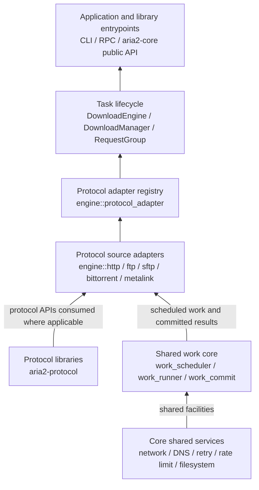

# Protocol Architecture

This document records where each protocol is implemented and how a download
travels from CLI/RPC input to network I/O. The structure follows ownership:
wire formats and reusable protocol clients live in `aria2-protocol`; task
policy and command execution live in `aria2-core`; CLI, RPC, and configuration
translation live in `aria2`.

## Layers, bottom to top



The diagram reads from foundation to application. Runtime calls go the other
way: CLI/RPC or a library caller adds a task; task lifecycle code starts a
tracked task, which asks `ProtocolAdapterRegistry` to select a registered
adapter. Each protocol adapter constructs its command and owns the protocol
setup it needs. The command supplies protocol-specific work items and request
rules to the shared work core. `WorkScheduler` owns generic queueing, bounded
admission, attempt counts, retry deadlines, and cancellation; `work_runner`
drives single-item attempts; `work_commit` enforces
validation-before-write-before-stable-persistence-before-checkpoint ordering
for complete work items. Adapters supply source requests, retry classification,
validation rules, and output/checkpoint handles. This keeps
transport and format policy with its source while the common work lifecycle is
independent of HTTP, FTP, SFTP, BitTorrent, or Metalink types.

The command registry and the work-item interface are separate seams. A new
protocol registers a command adapter and implements the shared work interfaces;
it does not add a branch to `task_spawner` or a protocol case to
`WorkScheduler`. HTTP/3 can use the same interfaces when its transport is added;
this change does not add an HTTP/3 network stack.

`aria2-protocol::http::HttpClient` and the standalone FTP client are public
protocol-library interfaces. The HTTP download engine uses its own reqwest
pool, network binding, redirect, cookie, retry, and task policies, so the
standalone HTTP client is not inserted as a redundant adapter in that route.

## Runtime request path

```text
CLI / RPC / library API
  → DownloadManager / DownloadEngine / RequestGroupMan
  → engine::task_spawner::spawn_download_task
  → engine::protocol_adapter::ProtocolAdapterRegistry
  → engine::<protocol>::command_adapter
  → protocol command
  → shared work scheduler / single-item runner
  → protocol source request and response
  → source validation → output write → stable-storage barrier → checkpoint
  → request/piece completion and task result
```

The Metalink adapter claims groups with Metalink source metadata before URI
dispatch. It expands metadata into payload request groups; each payload then
uses the adapter for its underlying route, such as HTTP, FTP, SFTP, or
BitTorrent. The built-in registry orders metadata and scheme-specific adapters
before the HTTP fallback. The HTTP adapter delegates construction to
`engine::http::command_factory`, which resolves target and proxy addresses.

## Shared work-item interface

`engine::work_scheduler::WorkScheduler<T>` is transport-neutral. A caller
queues typed payloads under opaque `WorkId`s, admits a bounded number of
leases, and reports completion, failure, or unstarted requeue. Retry budgets,
delayed work, cancellation, and active-lease validation live in that module.
`engine::work_runner::SingleWorkAdapter` uses the same scheduler for a single
logical item while allowing its adapter to classify source-specific errors and
wait interruptibly on task lifecycle changes.

`engine::work_commit::WorkCommitter` is for complete work items whose adapter
can define validation and persistence. Its order is received, validated,
written, durably persisted, then committed. `Committed` requires a successful
stable-storage barrier; a successful write into the operating-system page cache
alone is not persistence. Rust's `std::io::Write::flush` only drains writer
buffers. File-backed `DiskWriter::flush` explicitly follows it with
`File::sync_all` and a path namespace barrier; checkpoint paths use
`DiskWriter::sync_data` to sync payload contents and the initial output path
entry before advancing a sibling checkpoint. `SeekableDiskWriter::sync_all`
remains the barrier for positioned writes. On Unix the namespace barrier
synchronizes the containing directory chain after syncing the file. On Windows
it opens and flushes the containing directory handle; unsupported directory
barriers return an error. BitTorrent multi-file setup also syncs the parent
entry for each directory it creates, from the deepest new directory upward;
this avoids relying on write access to unrelated pre-existing ancestors.
Checkpoint replacement uses `MoveFileExW` with
`MOVEFILE_WRITE_THROUGH` as its rename barrier. Checkpoint files are advanced
only after payload synchronization succeeds. When a new checkpoint is based
on an existing resume prefix, the engine first syncs that existing payload
and its path entry. `File::sync_data` may skip nonessential file metadata and
some platforms implement it as `sync_all`.

Validation is source-defined. HTTP status, Content-Range, offset, and expected
body-length checks establish protocol correctness, but do not claim
cryptographic integrity unless an explicit digest is available and verified.
BitTorrent complete pieces are committed only after their v1/v2 piece hash is
verified and payload data is durably synced. Received BitTorrent blocks are
staged and may be structurally checked, but are not called committed pieces.
HTTP range chunks are likewise intermediate writes; a range lease completes
only after its output has crossed the stable-storage barrier. Streaming
protocols use `SequentialWorkCommitter` and sync before advancing a resumable
checkpoint. These paths keep network and protocol decisions outside the
generic scheduler.

Scheduler transition tests use the synchronous `WorkScheduler<T>` directly,
injecting `Instant` values for retry deadlines. They require no network,
filesystem, Tokio runtime, or wall-clock sleeps. Fake commit adapters separately
verify that persistence failure cannot advance a checkpoint or report a commit.

HTTP range/mirror coordination and BitTorrent peer/piece selection retain
their domain policies. They choose which work items to offer and what source
rules apply; the shared scheduler owns lease lifecycle, attempt budgets, and
retry admission.

## Protocol routes

| Input | Core command path | Protocol implementation | Result path |
|---|---|---|---|
| HTTP/HTTPS | `ProtocolAdapterRegistry` → `engine::http::command_adapter` → `command_factory` → `download_command`; range probing and concurrent requests use `segment_downloader`, `concurrent_download`, and `request_executor`; sequential bodies use `sequential_download`. | `aria2-protocol::http` owns reusable HTTP response types, HTTP/1.1 request serialization and incremental response-header parsing, Content-Disposition parsing, Basic/Bearer/Digest authentication syntax and header generation, Cookie and Set-Cookie wire syntax, Retry-After value parsing, and Metalink/HTTP Link/Digest parsing. Core's public HTTP request/response structs map through the protocol request serializer and response-head parser while retaining their historical API shapes. `aria2-core::http` owns cookie acceptance, scope, expiry, persistence and matching policy; request/response task policy; credential resolution and challenge retry state; filename destination policy; TLS identity; and client pools. Both HTTP and FTP CONNECT paths reuse the protocol Digest implementation. `engine::http::client_config` composes options, DNS answers, proxy settings, and outbound-address policy into reqwest clients. The standalone `aria2-protocol::http::HttpClient` remains a separate public client. | Range leases use `WorkScheduler`; chunks are intermediate writes, and completed ranges cross `sync_all` before scheduler completion. Sequential response checks establish HTTP protocol validity, not cryptographic integrity; file finalization and checkpoints use stable-storage barriers. HTTP mirror/range policy remains in the HTTP adapter. |
| FTP/FTPS | `ProtocolAdapterRegistry` → `engine::ftp::command_adapter` → `FtpDownloadCommand` → proxy GET or FTP control/data transfer. | `aria2-protocol::ftp::connection::FtpControlSession` owns FTP command sequencing, response parsing, and path/passive-mode grammar over an injected control stream. `aria2-protocol::ftp::tls::FtpsClient` owns reusable TLS configuration, TLS handshakes, and RFC 4217 protection negotiation. Core composes DNS/address policy, proxies, data sockets, active bind/accept policy, task lifecycle, and filesystem state. | `SingleWorkAdapter` supplies attempts; `SequentialWorkCommitter` writes chunks and syncs payload before advancing a checkpoint. Whole-file checksum policy uses the shared checksum service. |
| SFTP | `ProtocolAdapterRegistry` → `engine::sftp::command_adapter` → `SftpDownloadCommand` → `OutboundNetworkPolicy` TCP stream → `SshConnection::connect_with_stream` → `SftpSession` → `SftpFileOps`. | `aria2-protocol::sftp` owns SSH handshake/authentication, SFTP framing and request IDs, packet codec, and file operations. The adapter supplies URI/auth resolution, address policy, retry classification, and remote read offsets. | `SingleWorkAdapter` supplies attempts; source chunks use `SequentialWorkCommitter` for local writing, progress, and checkpoints. Payload is synced before checkpoint advancement. Whole-file checksum policy uses the shared checksum service. |
| BitTorrent | `ProtocolAdapterRegistry` → `engine::bittorrent::command_adapter`; torrent payloads use `download::command` → `download::execute`, while magnet input resolves metadata before the payload command. | `aria2-protocol::bittorrent` owns Bencode, torrent/magnet parsing, LPD announcement encoding/parsing, wire messages, TCP plain/MSE peer handshakes, DHT, tracker primitives, WebSocket tracker URL parsing/validation and handshake/framing/announce exchange, uTP packet/connection state machines, and BitTorrent peer handshake/framing. Core owns tracker URL selection, DNS/socket/proxy setup under outbound-address policy, process-level TCP/uTP listeners and the async uTP socket actor, shared info-hash routes, address/port binding policy, handshake admission limits, and peer-storage admission. The core LPD adapter attaches the observed sender and applies local-address classification; the core uTP peer adapter bridges actor handles to the protocol `PeerTransport` interface and maps errors without parsing BitTorrent handshakes or frames. The adapter owns peer discovery, availability, rarity/endgame selection, and per-piece hashes. | Core `WorkScheduler` leases piece and WebSeed work. Received blocks are staged after layout checks and can be checkpointed only after their payload is synced. Complete pieces pass v1/v2 hash validation, then stable-storage sync, then live completion/checkpoint publication through `WorkCommitter`; BT-specific peer feedback and piece accounting remain in the adapter. |
| Metalink | `ProtocolAdapterRegistry` → `engine::metalink::command_adapter` → `engine::metalink::download_command`; parsing uses `aria2-protocol::metalink` and expands through `engine::metalink::to_request_group`. | The adapter expands mirrors, hashes, and MetaURLs into payload tasks; metadata and payload retries use the shared single-item runner. Its HTTP client consumes the task `connect-timeout` while preserving the legacy 30-second fallback for direct core callers without that option. | Payload chunks pass through `SequentialWorkCommitter`, then each payload enters its supported URI source adapter, including HTTP, FTP, SFTP, or BitTorrent; Metalink does not implement a second byte-transfer protocol. |

### HTTP assembly and transfer path

1. `ProtocolAdapterRegistry` selects the HTTP adapter, which delegates
   command construction to `engine::http::command_factory`.
2. `command_factory` resolves the origin and proxy addresses when async DNS is
   enabled, then supplies those results and the outbound-address policy to
   `DownloadCommand`.
3. `download_command::constructor` calls `client_config` to build the primary
   reqwest client and range-client pool with the task's configured
   `connect-timeout`. The timeout participates in bound-client cache identity so
   tasks with different settings do not share an incompatible client. The
   command then owns request, auth, cookie,
   progress, and output-path state for the task.
4. `download_command::execute` prepares metadata and, when needed, probes Range
   support through `HttpSegmentDownloader::probe_range_metadata`. The probe
   returns the effective URL, entity length, and negotiated HTTP version.
5. If concurrent ranges are allowed, `ConcurrentDownloader::execute_with_retry`
   selects its single-source scheduler or multi-mirror pipeline. Each path
   submits generic leases through `WorkScheduler`; `request_executor` runs
   `HttpSegmentDownloader` requests and sends offset-bearing response chunks
   to the HTTP output adapter. A range lease is completed only after `sync_all`
   succeeds; requested checkpoint saves use the same payload barrier. For
   multi-mirror resume, compatible in-flight records restore only each
   parent's leading contiguous run of durable 16 KiB blocks; gaps and
   incompatible records are fetched again.
6. Otherwise, or after concurrent fallback, `SequentialDownloader` streams the
   response after HTTP status and body checks. These checks are protocol
   validation, not cryptographic integrity validation. The output sink writes
   chunks and syncs before advancing control-file checkpoints; finalization
   establishes stable storage before task completion. Gap filling retains its
   range-specific planning and fallback behavior. `DownloadCommand` then
   finalizes the request group.

### FTP/FTPS assembly and transfer path

1. `ProtocolAdapterRegistry` selects `engine::ftp::command_adapter`, which
   creates `FtpDownloadCommand`. Its constructor parses the FTP URI and maps
   request options into task state.
2. `FtpDownloadCommand::execute` owns the request lifecycle, retry policy,
   address refresh, cancellation, and checkpoint cleanup. Each attempt enters
   `execute_single_attempt`.
3. An HTTP proxy configured for FTP can take the direct proxy-GET path. Other
   proxy requests establish an HTTP CONNECT tunnel using the shared core
   CONNECT response reader and protocol-layer HTTP header parser; direct
   requests resolve origin addresses and connect through
   `OutboundNetworkPolicy`. Plain FTP, explicit FTPS, and implicit FTPS share
   `RawFtpControl`; both it and the standalone client pass their established
   control streams through `aria2-protocol::ftp::connection::FtpControlSession`,
   which owns FTP command semantics, command framing, and response parsing.
   FTPS upgrades and RFC 4217 negotiation use `aria2-protocol::ftp::tls::FtpsClient`;
   the client is created once per attempt and reuses its TLS connector for
   control and data channels.
4. The protocol session authenticates, selects TYPE, traverses the URI
   directory with PWD/CWD, and queries optional MDTM and SIZE metadata. Before
   RETR, core reconciles the remote size with the local file, continuation
   state, and checkpoint; dry-run and already-complete targets can finish here.
5. The protocol session negotiates EPSV/PASV or EPRT/PORT, applies REST when
   resuming, and sends RETR. Core establishes the data socket under its outbound
   policy and asks the FTPS client to upgrade data TLS when configured. Active-mode listening and acceptance use the shared
   `FtpActiveDataListener`; the core still controls bind address and advertised
   endpoint selection.
6. `receive_data_transfer` passes source chunks through the core
   `SequentialWorkCommitter`, which writes through `DiskWriter`, updates request
   progress, and syncs payload before advancing the existing checkpoint. The HTTP proxy GET route
   uses the same committer. The command retains rate-limit setup, transfer-length
   policy, checksum configuration, and FTP completion handling.

`aria2-protocol::ftp::connection::FtpConnection` plus
`aria2-protocol::ftp::download::FtpDownload` is a separate standalone client
API over direct plain-TCP connections. The engine does not call it because its
task route must compose core address binding, HTTP proxy modes, FTPS, and
`RequestGroup` lifecycle behavior. Both interfaces are kept at their own
boundaries; the standalone client is not an adapter around the engine command.

### SFTP assembly and transfer path

1. `ProtocolAdapterRegistry` selects `engine::sftp::command_adapter`, which
   creates `SftpDownloadCommand` and injects the process outbound-network
   policy and global rate limiter.
2. The command parses the SFTP URI, resolves credentials and output state, and
   builds SSH options including the configured host-key fingerprint policy.
3. The engine asks `OutboundNetworkPolicy` to create the target TCP stream and
   applies `sftp-connect-timeout` across that connection and
   `SshConnection::connect_with_stream`. The protocol
   module owns the SSH handshake, host-key check against the configured
   fingerprint or OpenSSH-format `known_hosts`, authentication, and subsystem
   channel. `AcceptNew` records only previously unseen host keys and rejects
   later changes; `Strict` rejects unknown keys. Its separate
   `SshConnection::connect` entry point is for standalone direct TCP use.
4. `SftpSession::open` sends INIT, negotiates the server version, and owns packet
   reads/writes, request IDs, serialized request/response exchanges, response-ID
   validation, operation counts, and timeouts. It reports typed
   `SftpSessionError` values for SSH, packet, channel, timeout, and correlation
   failures. `SftpFileOps` translates filesystem status packets into
   `FileOpError` and preserves session errors as sources; `SftpRemoteFile`
   provides positioned reads/writes and explicit handle closure with the same
   file-operation error type.
5. The engine stats and opens the remote file, reconciles the local length and
   checkpoint, then reads chunks at explicit offsets. It passes each chunk
   through the core `SequentialWorkCommitter` for local writing and progress;
   the payload is synced before checkpoint updates and final checksum
   verification/task completion.

`aria2-protocol::sftp::transfer::SftpTransfer` remains a public standalone
transfer interface. It adds local-file I/O, configurable buffering, resume,
progress callbacks, and optional source permission and timestamp preservation
over `SftpFileOps`.
It returns typed `TransferError` values with the original SFTP or local I/O
error preserved as a source. Resume inspection treats only an explicit
not-found response as unsupported; transport and permission failures propagate.
The engine does not call it because the engine path must write through its
`DiskWriter` and `RequestGroup` checkpoint lifecycle.

HTTP trackers, UDP trackers, WebSeeds, and DHT remain under BitTorrent because
their retry, announce, peer, lookup, and piece semantics are BitTorrent
behavior. UDP tracker framing and packet codecs live in
`aria2-protocol::bittorrent::tracker`; core resolves tracker addresses through
`OutboundNetworkPolicy`, binds the UDP socket, and owns transaction retries and
announce lifecycle. DHT wire and lookup primitives live in
`aria2-protocol::bittorrent`; torrent-scoped lookup scheduling and process
ownership live in `aria2-core::engine::bittorrent`.
HTTP tracker requests use reqwest: under the direct network policy there is no
local source address to select, so the request client owns DNS and proxy
routing. Host resolution is needed for source-family matching only when an
explicit outbound address/interface is configured; pre-resolving in direct
mode can reject an announce before the HTTP client starts it.
Local Peer Discovery is composed across the protocol and engine layers:
`aria2-protocol::bittorrent::lpd` encodes and parses BEP 14 and the legacy
announcement format; core owns the multicast socket, receive loop, sender-address
classification, peer-registry updates, and torrent-activity lifecycle under
`engine::bittorrent::discovery::lpd`.

### BitTorrent assembly and transfer path

1. `ProtocolAdapterRegistry` selects `engine::bittorrent::command_adapter` for
   existing torrent metadata, a `bt://` request, or a `magnet:` URI. It routes
   payloads to `BtDownloadCommand` and magnets to `MagnetDownloadCommand`.
2. The magnet command uses the protocol library's `MagnetLink` parser, then
   resolves metadata in this order: a saved torrent when enabled, an `xs`
   exact source, tracker-discovered peers, then DHT-discovered peers and BEP 9
   metadata exchange. `metadata_source` coordinates those sources;
   `discovery` owns tracker/DHT peer lookup; core `metadata` owns saved files
   and info-hash checks. `aria2-protocol::bittorrent::torrent::metainfo` owns
   the pure bencode transformations that wrap BEP 9 info dictionaries and
   merge magnet WebSeeds into torrent metainfo.
3. Before payload transfer, the command enforces the private-torrent DHT rule,
   optionally saves the complete torrent metadata, and completes immediately
   for metadata-only requests. Otherwise it constructs `BtDownloadCommand`
   with the existing `RequestGroup`, the resolved torrent bytes, and the
   outbound-network policy. Any DHT engines acquired for metadata discovery
   are handed to that command so the payload stage can reuse them.
   For payload downloads, the validated, normalized metainfo is also retained
   on that same group before handoff. Session snapshots encode it in the
   existing `aria2-rust-bt-metadata-data` field, allowing a restored magnet task
   to start directly from its metainfo without needing the original `xs`
   source or repeating BEP 9 discovery. Metadata-only requests complete before
   this payload-resume snapshot is installed.
4. `BtDownloadCommand::execute` prepares the torrent layout and integrity
   state, then coordinates tracker/DHT discovery, peer sessions, piece
   selection, and WebSeeds through `download::execute`. The piece source uses
   the core `WorkScheduler` for work leases. Received blocks are staged after
   layout checks; their in-flight checkpoint bits are published only after
   payload sync. Complete pieces pass their v1/v2 hash validator, are written
   and synced, then become live-complete and eligible for checkpoint publication
   through `WorkCommitter`.
   Peer wire messages, TCP peer protocol, torrent-geometry and negotiated-
   capability validation, and per-peer protocol-session state use
   `aria2-protocol::bittorrent`;
   core owns peer selection, outbound network policy, and the process uTP actor.
   Bad-peer feedback remains BitTorrent-specific engine policy.
5. Peer interaction selects uTP, MSE, or a plain TCP fallback from task
   settings. For TCP, core establishes the policy-approved stream and passes it
   to the protocol crate's plain or MSE handshake; both return the same
   `PeerConnection`, which owns message framing and applies MSE encryption when
   negotiated. For uTP, core owns the process transport actor and adapts its
   byte stream to protocol `PeerWireSession`, which owns the handshake and
   message framing. Protocol `PeerState` tracks choke/interest/request state,
   while `PeerSessionResource` tracks torrent geometry, availability, and
   negotiated extensions. `BtPeerConn` then adds engine peer identity, upload
   policy state, and statistics. Once
   initialized, it is moved into a long-lived `PeerActor`; that actor is the
   sole runtime owner of the connection and performs its socket reads/writes.
   Coordinators send peer commands and consume peer events rather than doing
   parallel socket I/O. `BtPeerConn` therefore remains the actor-owned
   connection/state object at runtime; only pre-actor ownership is temporary.
   BEP 11 payload encoding, compact-address conversion, and message framing use
   protocol types; core selects, filters, and schedules the peers to advertise.
   The torrent-scoped `TorrentSession` owns the `PeerSwarm`, which the
   piece-download coordinator borrows and then transfers into seeding. Magnet
   metadata actors are activated for payload in place, preserving the same
   connections and registry across that transition.
   Incoming TCP follows the same boundary: core accepts under its shared
   handshake limit and snapshots the live info-hash routes and their MSE
   policies; protocol `incoming::receive_with_options` parses and negotiates
   the handshake, then exposes the parsed info-hash (MSE checks its candidate
   against the supplied route set). Core selects the
   current route, asks the protocol result to complete the local handshake,
   and applies peer-storage/mailbox admission without reparsing wire bytes.
6. `TrackerAnnouncer` selects one tracker URL from `BtAnnounce`, resolves UDP
   tracker addresses through the outbound policy, and calls the core UDP
   client. The retained `AnnounceList` manages multi-tier URL order and failure
   rotation; the UDP client sends CONNECT then ANNOUNCE/SCRAPE using the
   protocol crate's packet codecs. Only the redundant UDP-specific manager and
   duplicate synchronous protocol client were removed.
   If a bencoded HTTP tracker response includes an `announce-list` field, the
   client treats it as an additional tracker extension and appends unseen
   tiers without replacing configured primary tiers; the actor's separate
   public-tracker fan-out remains independent. A later primary failure can
   select the added tiers. This is a Rust extension: upstream aria2's
   response handler does not consume that field, and BEP 15's fixed binary UDP
   announce response has no URL-list field.
7. The process-level `BtPeerListenerManager` owns uTP transport actors keyed by
   local endpoint. It passes the configured `UtpSocketOptions` to each new
   socket; CLI, global RPC updates, and the C API all update this process-level
   configuration. Existing actors retain the options they were created with
   because each socket is shared across torrent routes. If an actor exits,
   existing peer handles fail and may fall back to TCP; a later registration
   reaps the stopped actor and creates a fresh one for that endpoint.
8. `PublicTrackerList` owns remote source-list fetching and its complete
   response deadline. The protocol library exposes that timeout separately
   from `TrackerCatalogConfig`, preserving that public struct's existing
   construction API. Core owns CLI/RPC/C API translation and sends runtime
   updates to the catalog; an active source fetch keeps its captured deadline.

### DHT inbound query path

The DHT engine is assembled from the UDP socket, routing table, KRPC services,
and bounded lookup scheduler. `engine/startup.rs::DhtEngine::start` loads the
family-specific state, binds the socket, builds the shared engine context, then
starts the inbound loop in `engine/receive.rs` and maintenance loops in
`engine_inner.rs`. `engine/api.rs` exposes peer lookup, announce, and BEP 44/51
operations; `engine/lifecycle.rs` owns bootstrap state, shutdown, and statistics.
`RoutingTable` owns node admission and health queries; `Bucket` owns node
membership and replacement candidates; `DhtNode` records responsiveness; the
private `bucket_tree` module owns bucket splitting and tree traversal.

Core translates the process outbound-network policy into the DHT socket's
family-specific bind address before creating the protocol engine. Under a
constrained policy, it skips a family with no compatible source and rejects a
conflicting explicit DHT listen address; only direct routing may use a wildcard
bind. The protocol engine owns the bound UDP socket and all subsequent DHT
traffic.

`DhtEngineContext` stores one `DhtTaskContext` for the effective local node ID,
routing table, UDP socket, transaction tracker, and query timeout used at
runtime. Startup copies the configured timeout into that context. `DhtEngineInner`
stores only mutable lifecycle state, so direct engine calls, background loops,
and scheduled tasks share the same protocol resources.

1. `DhtSocket` is the sole UDP reader. `engine/receive.rs` distributes datagrams
   round-robin through bounded worker queues, skips full or closed workers, and
   drops a packet only when no queue accepts it. The KRPC decoder accepts only
   exact `y` values (`q`, `r`, or `e`), requires response dictionaries to carry
   a 20-byte node ID, and validates the two-field error shape. Invalid messages
   are dropped before they reach shared state. Responses and errors go to the
   transaction tracker. Unknown transactions and replies from the wrong source
   are ignored; a valid KRPC error closes its matched waiter as a failure so the
   querying task updates node health through the same path as a timeout.
   Queries enter `DhtQueryHandler`. Shutdown closes queue senders, drains
   pending packets for up to 100 ms, then aborts workers that are still blocked.
2. The handler validates the query method and sender node ID, ignores packets
   from the local node, then dispatches `ping`, `find_node`, `get_peers`, and
   `announce_peer` to the BEP 5 handlers. `items` owns BEP 44 `get`/`put`, and
   `sample` owns BEP 51 `sample_infohashes`; sampling depends on peer storage,
   not on the optional BEP 44 item store.
3. `HandleResult` carries the response and an optional sender ID eligible for
   promotion. The engine releases the routing-table and token locks, sends the
   response, then promotes an accepted sender into the routing table.

### DHT background maintenance path

1. `engine_inner.rs::spawn_periodic_tasks` owns the maintenance timers and
   submits work to the bounded `DhtTaskQueue`; it does not perform network or
   persistence work in the timer loop. Token rotation is the synchronous
   exception and updates the token tracker directly.
2. Bucket refresh runs in periodic lane 1 through `BucketRefreshTask`.
   Node contact and cleanup run in periodic lane 2 through `MaintenanceTask`:
   contact selects one good node per bucket and issues bounded `PingTask`s;
   cleanup expires peer and transaction state, then evicts bad nodes and
   attempts cached replacements. These network-maintenance ticks are skipped
   while lane 2 is busy, preventing overlapping stale work.
3. Routing-table saves use the same lane but are queued even when it is busy.
   `MaintenanceTask` is the adapter required by the shared `DhtTask` queue;
   its variants each perform a distinct engine operation. The public
   `save_state` and `evict_nodes` methods call those same operations directly
   for on-demand requests.

### DHT persistence path

1. `engine/startup.rs::DhtEngine::start` reads the configured family-specific
   snapshot, accepts it only within `persistence_max_age`, and inserts restored
   nodes as unverified routing candidates.
2. Periodic saves, `save_state`, and shutdown all call
   `DhtEngineContext::save_state`. Shutdown first stops queued and background
   work, then reuses this method. It collects current good nodes;
   `DhtPersistence` serializes that single snapshot and atomically replaces the
   file under its cross-process file lock. Expired or evicted nodes are not
   merged back from an older snapshot.
3. The BEP 44 item store uses its own `.items` file. Both file writes run
   outside the async runtime and are attempted independently; one write failure
   does not suppress the other, and the shared method reports either or both
   errors.

Magnet is a metadata-resolution stage, not a second payload downloader. Both
magnet and `.torrent` inputs converge on the same `BtDownloadCommand` and piece
execution path. The command's implementation is split by its actual internal
roles under `magnet/download_command/`; those modules are private and do not
add another task-facing interface.

## Ownership rules

- `aria2-protocol/src/{http,ftp,sftp,bittorrent,metalink}` is the lower
  protocol-library layer. A protocol module owns its wire representation and
  reusable protocol-specific operations; it does not depend on `aria2-core`.
- `aria2-core/src/engine/{http,ftp,sftp,bittorrent,metalink}` owns protocol
  commands and behavior that depends on request groups, storage, retries,
  scheduling, or process-wide state. Protocol-specific code stays in its
  protocol directory.
- `aria2-core/src/engine` keeps cross-protocol work: task lifecycle, dispatch,
  work scheduling/running/commit, checkpoints, and engine services. HTTP
  range/mirror planners remain HTTP domain policy even though their existing
  public modules are rooted under `engine`. The HTTP-only cookie helper,
  concurrent downloader, range-probe path, and sequential downloader live under
  `engine/http`; protocol-specific work does not remain at engine root just
  because it is shared by HTTP transfer strategies. HTTP target/proxy DNS resolution is owned by
  `engine/http/command_factory`, and reqwest client construction is owned by
  `engine/http/client_config`.
- `aria2-core/src/{http,ftp,network}` owns shared core policy and helpers used
  by the engine. These directories are distinct from the similarly named
  engine directories: the former implement reusable policy; the latter
  assemble that policy into a download command.
- `aria2-core` crate-root exports remain the supported application library
  surface. The engine directory layout is an implementation seam; applications
  should use the task-facing types re-exported from `aria2_core`.

The standalone `aria2-protocol::http::HttpClient` and FTP client APIs have their
own public library interfaces and direct tests. The active FTP task route uses
the task command described above; the protocol crate's standalone
`FtpConnection`/`FtpDownload` remains a distinct external client API. The core
also exposes `aria2-core::http::connection`, `aria2-core::ftp::connection`, and
`aria2-core::ftp::connection_pool` as public library interfaces. These APIs
remain at their existing boundaries: the HTTP task path composes reqwest with
pooling, address binding, request policy, and task lifecycle, while the FTP
task path composes its control/data flow with core network policy and
protocol-layer FTP/FTPS behavior.
Do not add pass-through engine clients around these public interfaces.

## Module audit

- **Keep** the protocol-library folders and their codecs, clients, parsers,
  and transport-specific state. They provide independently usable protocol
  behavior.
- **Keep** shared engine modules at `engine` level when they own cross-protocol
  lifecycle or a reusable coordination interface, including `task_spawner`,
  `protocol_adapter`, `concurrent_segment_manager`, and `mirror_coordinator`.
- **Narrow** the former flat collection of `bt_*`, `http_*`, FTP, SFTP, and
  Metalink engine modules into the protocol directories above. This is a source
  organization and module-path change; it does not alter download semantics,
  wire behavior, or task-facing crate-root exports. HTTP engine modules now
  have one canonical path under `engine/http` without legacy path re-exports.
- **Narrow** `task_spawner` to tracked task creation and lifecycle cleanup.
  `ProtocolAdapterRegistry` selects the first supporting adapter; each protocol
  directory owns its command construction and dependency setup. HTTP is the
  final fallback, after metadata and scheme-specific adapters.
- **Narrow** HTTP construction to its protocol directory: the HTTP factory now
  owns target/proxy DNS resolution, and `client_config` owns reqwest setup.
  Generic task dispatch no longer assembles HTTP-specific addresses or client
  options.
- **Narrow** the core HTTP header-processor module to a compatibility adapter.
  The incremental HTTP/1.x parser and response-head model now live in
  `aria2-protocol::http::header_processor`; core keeps its historic entrypoint
  and maps protocol parse errors to `Aria2Error`.
- **Narrow** Linux splice HTTP parsing to the shared protocol header parser.
  The splice path retains its Linux socket/file I/O and fallback decisions;
  header framing and response syntax use `aria2-protocol::http::header_processor`.
- **Narrow** raw HTTP request framing in proxy and splice paths to
  `aria2-protocol::http::request`. Core keeps proxy routing, auth retries,
  Range policy, outbound networking and zero-copy transfer decisions.
- **Narrow** SOCKS4/5 wire handshakes into `aria2-protocol::socks`. Core keeps
  the public connector types as adapters and retains proxy URL/configuration,
  no-proxy matching, connector selection, and outbound socket policy.
- **Narrow** the core Metalink/HTTP module to compatibility exports. Link and
  Digest header parsing and its values live in
  `aria2-protocol::http::metalink_http`; task integration remains in the core
  HTTP response processor.
- **Narrow** Content-Disposition parsing into
  `aria2-protocol::http::content_disposition`. Core retains the historical
  module path and applies filename destination and filesystem policy after
  decoding the protocol field.
- **Narrow** HTTP cookie wire parsing into
  `aria2-protocol::http::cookie::parsing`: date parsing/formatting, host/domain
  matching, numeric-host recognition, path matching, request Cookie pairs, and
  Set-Cookie fields. Core keeps the historical helper path as a re-export,
  along with cookie acceptance, persistence, selection, expiration scheduling,
  and request attachment policy.
- **Narrow** HTTP Digest challenge parsing and parameter validation into
  `aria2-protocol::http::digest`. Core keeps the established challenge type and
  error mapping for library compatibility, plus credential resolution and
  challenge retry state. The engine-facing Digest response hashing and header
  serialization use the protocol implementation.
- **Narrow** the protocol crate's legacy `HttpAuth` API and core Basic/Bearer
  header helpers to compatibility wrappers over the protocol authentication
  parser and serializers. The public helper signatures remain stable.
- **Keep** the public core `HttpResponse` shape while delegating complete
  response-head parsing to the protocol HTTP parser; core converts the parsed
  header model and preserves the body as opaque bytes.
- **Narrow** HTTP/1.1 request-line, header, and body framing into
  `aria2-protocol::http::request::HttpRequest::to_bytes`. Core retains its
  option-driven request construction and FTP-proxy GET policy, then uses the
  protocol serializer. Public core request types keep their existing APIs.
- **Narrow** the public `aria2_core::auth::digest_auth` API into a compatibility
  facade: challenge syntax and Digest hashing/header generation use
  `aria2-protocol::http::digest`, while the core retains its public value types,
  provider abstraction, zeroizing secret storage, nonce counter, and
  HTTPS-only Basic policy.
- **Narrow** HTTP transfer/content coding selection and incremental chunked,
  GZip, Deflate, and BZip2 decoding into
  `aria2-protocol::http::stream_filter`. Core keeps its public decoder types,
  selector, and `StreamFilter` interface as compatibility adapters; response
  lifecycle, filter-chain execution, and the null sink remain in core.
- **Keep** `aria2_protocol::http::encoding::{HttpEncoding, ChunkedDecoder}`
  as the public whole-buffer compatibility interface. There are no in-repository
  production callers, and its accepted input/error behavior differs from the
  incremental decoder path; routing it through the streaming API would change
  observable behavior for external library users.
- **Narrow** HTTP `Retry-After` syntax into the protocol response module.
  Core supplies the current time and keeps the five-minute retry cap and
  scheduler behavior.
- **Narrow** range probing to `HttpSegmentDownloader::probe_range_metadata`.
  The former `RangeProber` only forwarded configuration and the probe call, so
  its tests now exercise the downloader interface directly.
- **Narrow** HTTP command execution by moving rate-limited Range probe retry
  handling into `download_command::range_probe_work`; the command executor
  retains request selection, output policy, and transfer orchestration while
  the adapter owns the shared `SingleWorkAdapter` retry contract. Move
  sequential-downloader unit tests to the adjacent `tests.rs` module and move
  the prepared-GET and sequential-checkpoint cases into a focused resume test
  module; these source-layout changes preserve interfaces and transfer
  behavior.
- **Keep** HTTP adaptive concurrency in the core engine: it owns admission,
  per-source feedback, pacing and recovery policy; the protocol client only
  performs the HTTP requests. Keep its policy tests in an adjacent test module.
- **Keep** the public `aria2_core::http::connection::HttpConnectionManager`
  as a standalone low-level library API. It has no production callers in the
  download engine; callers provide `HttpConfig`, including its independent
  connect timeout. The active HTTP task path remains the reqwest-based engine
  described above, so this API is not an unconfigured bypass of task options.
- **Improve** sequential HTTP gap filling: derive completed progress from the
  normalized missing ranges so overlapping input ranges cannot be double
  counted, clip out-of-file coverage while planning gaps, and cross
  `SeekableDiskWriter::sync_all` before recording gap completion in a control
  file or completing the task. Keep redirect handling, cancellation, rate
  limiting, and checkpoint lifecycle in the core downloader. Move its direct
  tests into the adjacent `gap_download/tests.rs` module.
- **Narrow** active-range bookkeeping in
  `engine::http::concurrent_download::segment`: replace the positional
  `(offset, length, started_at, task_id)` tuple with a named `ActiveSegment`
  record, and register it only after the executor accepts the request. The
  single-mirror event loop remains the owner of scheduling, completion,
  cancellation and checkpoint ordering; `concurrent_download::mod` is its only
  production caller. Bounded admission and stall/slow-outlier lease recovery
  live in `segment::admission` and `segment::stall`, respectively; both update
  executor connection snapshots through `segment::executor`. Success
  checkpointing, Range-size rejection, capacity retry, ordinary retry, and 416
  fallback decisions live in `segment::completion`; it returns an action while
  the event loop retains executor cancellation and lifecycle ownership.
- **Narrow** multi-mirror HTTP Range result handling into
  `concurrent_download::pipeline::completion`. It owns successful range
  checkpoint transitions, authority-scoped Range-size adaptation, capacity
  retries, mirror failover decisions, retry accounting, and 416 fallback
  detection. The pipeline event loop retains executor task reaping, terminal
  cancellation/persistence, shared progress publication, and lifecycle control.
- **Narrow** FTP download source layout: public options/results are grouped in
  `aria2-protocol/src/ftp/download/types.rs`, transfer behavior stays in
  `download.rs`, and its direct tests live beside them. The module exports its
  canonical public types at the owning module boundary.
- **Narrow** FTP/FTPS and SFTP URI syntax into `aria2-protocol::ftp::uri` and
  `aria2-protocol::sftp::uri`. The protocol crate parses scheme, authority,
  credentials, port, and remote path; core maps protocol parse outcomes into
  task errors and applies anonymous FTP defaults, SFTP credential precedence,
  FTPS configuration, output naming, and task lifecycle. The parsed secure-scheme
  flag is carried into core policy without reparsing the URI. FTP and SFTP
  default ports are defined by their protocol modules; the public core constants
  remain aliases for compatibility. FTP percent decoding and user-info
  percent-encoding are owned by the URI module; the decoder remains
  re-exported through the historical connection module path for compatibility.
  SFTP decoding remains in its URI parser rather than the engine.
- **Narrow** FTP engine parser access: `download_command` imports the core FTP
  parsers directly instead of re-exporting them through its control module.
  Remove the unused private FTP error classifier; live response handling stays
  in the control commands and attempt retry path.
- **Narrow** FTP duplication by sharing injected control-stream line I/O and
  active data listener acceptance between the standalone protocol client and
  task engine. PASV/EPSV response syntax has one parser in the protocol crate;
  callers retain their command-status handling, EPSV fallback, endpoint trust,
  and connection policy. The core retains address binding, proxy selection,
  data-socket policy, and task lifecycle. FTPS TLS and RFC 4217 negotiation
  live in the protocol crate. The standalone client remains a distinct
  public client rather than a forwarding stage in the engine route.
- **Improve** FTPS TLS setup with a protocol-layer `FtpsClient` that builds one
  rustls connector per attempt and reuses it for control and data-channel
  handshakes. The engine selects direct/proxy and explicit/implicit connection
  paths; it does not construct TLS connectors or issue RFC 4217 commands.
- **Narrow** FTP response input to the upstream 64 KiB limit in both the
  standalone client and injected control session. The shared bounded line
  reader checks the remaining response budget before growing the line buffer,
  including for a single oversized line.
- **Narrow** SFTP source layout into connection options/lifecycle,
  packet constants/types/attributes/codec/wire helpers, session request
  tracking, file-operation values, and separate standalone download/upload
  implementations. Each module exports its canonical public types at the
  owning module boundary. Keep the standalone `SftpTransfer` interface
  separate from the engine's request-group and `DiskWriter` lifecycle.
- **Delete** the unused SFTP SSH connection pool. It had no production callers,
  keyed connections without authentication or host-key policy, treated
  connection age as idle time, and could only drop pool references when asked
  to close. Callers can reuse an `SshConnection` directly when they need
  multiple SFTP channels.
- **Narrow** SFTP error handling by layer: the session returns typed
  `SftpSessionError` values for SSH, packet codec, channel I/O, timeout, and
  protocol negotiation or response correlation; file operations add their
  operation context and map server status codes into `FileOpError`. One
  serialized request path assigns and validates IDs, so the unused pending-map
  tracker and unpaired public send/receive methods are removed. Each completed
  exchange is counted once. The standalone transfer returns typed errors with
  low-level sources intact; the engine maps session and file-operation failures
  into task errors.
- **Narrow** Metalink expansion to one parse and selection pass that produces
  direct-resource groups and, when enabled, torrent metadata graphs from the
  same normalized entries and GID sequence. Remove the unused mirror types and
  forwarding entry points; `MetalinkFile` remains the parsed protocol model,
  while the core owns task expansion and lifecycle.
- **Narrow** the BitTorrent peer-connection seam: protocol owns plain/MSE
  handshakes, encryption, and one TCP message connection; core supplies the
  selected stream and assembles `BtPeerConn`. Incoming route selection also
  returns that same TCP connection type. Magnet metadata exchange uses parsed
  BitTorrent messages instead of a second raw-frame reader. The core uTP actor
  remains the process-owned async driver for the protocol library's `UtpSocket`;
  the uTP peer adapter bridges actor handles to protocol `PeerTransport` and
  carries `PeerWireSession`, so BitTorrent handshake and message framing stay
  in protocol. Require explicit outbound network policy for peer and UDP
  tracker entry points; remove direct-connect shortcuts, duplicate encrypted
  connection forwarding, and redundant incoming constructors. Core retains
  torrent-specific peer state at the engine seam.
- **Narrow** BitTorrent metainfo responsibilities: the protocol crate owns
  parsing and pure bencode transformations, including `url-list` extraction,
  BEP 9 info-dictionary wrapping, and magnet WebSeed merging. Core retains
  metadata-source selection, saved-file I/O, expected-info-hash validation,
  and download lifecycle decisions.
- **Keep** `aria2_protocol::bittorrent::message::factory` as the public typed
  frame parser. It owns length-prefix validation, message-specific payload
  parsing, incremental byte-buffer parsing, and the zero-copy `Piece` payload
  path; `message::serializer` remains the independent outbound encoder. Core
  and protocol peer sessions consume these parser entry points. Move the
  factory tests to its adjacent `factory/tests.rs` module without changing
  public paths or parse behavior.
- **Narrow** BitTorrent Local Peer Discovery defaults into the protocol crate:
  the BEP 14 multicast address and UDP port have protocol-library definitions,
  while public core constants remain aliases. Core retains announce cadence,
  socket lifecycle, local-address classification, and peer admission policy.
- **Narrow** UDP tracker ownership: protocol contains only BEP 15 packet
  encoding and decoding; core owns policy-based DNS and binding, one-shot
  announce/scrape exchanges, transaction state, and timeout/retry handling.
  `AnnounceList` keeps URL order, tiers, and failure rotation; the UDP client
  receives only the currently selected URL. Keep this multi-tier tracker
  manager; remove only the duplicate synchronous client and UDP-specific
  execution manager. Resolve the selected URL once and reuse its address; DNS
  failures stay inside the outbound-policy boundary.
- **Keep** `bittorrent::utp::packet` and
  `bittorrent::tracker::udp_tracker_protocol` as protocol-owned wire codecs.
  The former validates uTP packet fields and extensions; the latter encodes
  and decodes BEP 15 messages. Socket actors, tracker exchange lifecycle,
  policy, and retry timing stay in their existing owning modules. Move their
  codec tests to adjacent submodules without changing the public codec paths.
- **Narrow** WebSocket tracker URL handling: the protocol crate owns URL syntax
  and `ws`/`wss` validation, while core uses the parsed endpoint for
  policy-controlled DNS, proxy, and socket setup.
- **Narrow** `PublicTrackerList` source organization: keep catalog state,
  refresh lifecycle, health backoff, and the existing public types at their
  original module paths; move URL parsing and embedded tracker data to a private
  parser submodule and unit tests to `public_list/tests.rs`.
- **Narrow** HTTP client and protocol test source layout: retain the HTTP
  request/response client interface while moving its tests beside the client;
  group Content-Disposition compatibility cases and DHT UDP pressure coverage
  in separate test modules so each source file remains focused and bounded.
- **Narrow** DHT peer task composition: one `PeerLookupTask` performs the
  iterative `get_peers` traversal and can announce with tokens from that same
  traversal. Remove the duplicate `PeerAnnounceTask`; both peer discovery and
  explicit `announce_peer` use the same task path.
- **Delete** `DhtTaskFactory`, which only forwarded the shared context to task
  constructors. The engine now constructs the scheduled task directly, making
  task selection and its inputs visible at the scheduling point.
- **Delete** `NodeLookupTask`: it duplicated the public result-returning
  `lookup::iterative_find_node`, discarded its `NodeLookupResult`, and had no
  production callers. `BucketRefreshTask` keeps bounded fan-out while selecting
  stale bucket targets; callers that need one lookup can call the lookup API.
- **Narrow** DHT iterative queries by responsibility (`find_node`, `get_peers`,
  BEP 44 items, BEP 51 sampling, and announce) while keeping candidate
  ordering and query batching in the shared lookup module. Keep transaction
  matching in one RAII response-wait path; remove unused per-transaction
  `info_hash` and token storage.
- **Narrow** outbound KRPC encoding to bytes: the bencode writer is
  infallible, so `DhtMessage::encode` returns its buffer without a redundant
  `Result` layer. Keep parsing errors at the `decode` boundary and pass
  announce tokens as opaque bytes.
- **Narrow** the DHT UDP seam: keep the Tokio socket behind `DhtSocket` and
  route the engine receive loop through it instead of exposing the raw shared
  socket. The engine still handles timeout and shutdown selection around reads.
- **Narrow** DHT persistence to one current-good-node snapshot path. Keep the
  file lock and atomic replacement, remove the unused read/merge/write path
  that could restore evicted nodes, and collect good nodes at the routing-table
  boundary. The binary serializer is infallible; parse errors and filesystem
  failures remain at their respective decode and I/O boundaries.
- **Narrow** inbound DHT query handling by protocol responsibility: shared sender
  validation and dispatch stay in `DhtQueryHandler`; BEP 44 item operations and
  BEP 51 sampling live in focused submodules. Keep one handler entry point with
  an optional item store, and remove its former no-store forwarding overload.
- **Delete** the unregistered `peer_choke_command.rs` file, which had no `engine` module
  declaration, call sites, or reachable public API. It was removed as dead
  source; active choking state and execution remain with BitTorrent peer
  storage and its choke manager.
- **Keep** public interfaces when they provide a documented standalone protocol
  capability or a useful ownership boundary. Remove aliases and forwarding
  variants that duplicate the canonical entry point. The `engine` module
  layout follows internal ownership.
- **Keep** `aria2_protocol::bittorrent::peer::listener::PeerListener`, a public
  standalone TCP accept helper. It binds one wildcard IPv4 socket and forwards
  raw accepted streams; it performs no handshake or torrent routing, and the
  built-in engine does not use it. Keep this public helper for callers that want
  standalone acceptance. The core `BtPeerListenerManager` owns process-level
  binding, shared torrent routes, handshake admission, storage admission, and
  shutdown/draining across TCP listeners and uTP actors. Protocol handshake
  operations remain in `aria2-protocol`; moving the manager there would pull
  core peer-storage and task-admission policy into the lower-level crate.
- **Narrow** `DownloadManager` source organization into its submission/query facade,
  per-download handle, and engine-lifecycle handle. Keep the crate-root
  re-exports and observable behavior unchanged; organize its interface tests by
  waiting, lifecycle, queries, and submissions.
- **Narrow** download event-hook source organization: keep public event,
  listener, and hook-manager types at their existing module paths; place the
  bus registration/dispatch implementation in a private child module, with
  tests separate. The shell-command and observer sinks remain independent, and
  RPC notification adaptation remains above `aria2-core`.
- **Narrow** runtime option policy into public compatibility tables and a
  private classification/projection module. Re-export the existing policy
  functions at `config::runtime`, keeping CLI, RPC, and C API adapters on the
  same core-owned rules and preserving their existing paths.
- **Narrow** session option serialization by option domain (basic,
  integrity/Metalink, BitTorrent, network, and lifecycle). Keep the public
  `download_options_to_map` boundary as the single coordinator and retain the
  existing session keys and snapshot-preservation path.
- **Keep** `ConfigParser` as the core-owned source-precedence and validation
  boundary shared by CLI/config-file/environment adapters; move its tests to an
  adjacent module while preserving the parser interface.
- **Keep** runtime option application and lifecycle classification in core.
  RPC normalizes wire values in `aria2`, while the C API converts its string
  pairs at its own boundary; both converge on the public core option-update
  contract. Core owns immediate versus pending application and active-task
  restart semantics, which depend on request-group state.
- **Narrow** SFTP session option restoration to the shared
  `DownloadOptions::from_option_strings` parser. Do not manually reparse
  selected persisted SFTP fields after construction, which bypasses shared
  value handling and can restore invalid timeout values.
- **Improve** SFTP connection timeout and cancellation handling: bound the
  policy-based DNS/TCP connection plus SSH setup with the configured timeout,
  and release outbound-source in-flight accounting through RAII when the
  timed connection future is cancelled.
- **Keep** process-engine option assembly in core at
  `engine::download_engine::DownloadEngine::from_process_options`.
  CLI and C API pass typed option snapshots through this single boundary for
  outbound networking, DNS, server statistics, scheduler/rate limits, and
  BitTorrent tracker/uTP/LPD setup. Application-only save-session policy stays
  in the CLI. Global runtime updates continue to use explicit `EngineCommand`
  variants, preserving original aria2's dispatch model and Rust's documented
  runtime extensions.
- **Narrow** `BtRegistry` implementation by responsibility: info-hash lookup,
  pool/index lifecycle, component access, DHT lifecycle, completion/torrent
  attributes, ports, and peer blocklist live in private child modules. The
  `BtRegistry` public method paths and caller contract remain unchanged.
- **Keep** LPD multicast sockets, receive/announce task lifecycle, active-torrent
  filtering, and peer admission in core. `aria2-protocol` owns BEP 14 message
  encoding/parsing; core enriches received peers with sender address policy and
  stores engine-facing discovery state. Keep the `LpdPeer` public module path
  while placing its data model in the private `lpd::peer` child module.- **Narrow** tracker announce source organization: UDP event/response adaptation
  lives beside the announce state machine in a private child module; tracker
  state and its existing public API remain owned by `BtAnnounce`.- **Keep** the BitTorrent process listener as the shared TCP/uTP info-hash
  router. Its clones share one listener lifecycle, which is cancelled only when
  the final manager owner is dropped; route handles still independently remove
  their torrent registration. Each accept/dispatch loop owns and drains its
  per-connection handshake tasks on shutdown. Dropping one route cancels its
  in-flight TCP/uTP handshake completion and mailbox delivery; a peer-admission
  guard returns storage ownership if delivery is cancelled. Keep its loopback
  lifecycle tests in the adjacent `peer/listener/tests.rs` file. TCP accept
  errors use capped exponential retry delays so a transient OS error does not
  silently terminate the process listener while its socket and routes remain
  registered.
- **Delete** the unused `BtConnectionPool` and `ReadyConnection` raw TCP
  prewarm helper. Repository-wide call-site inspection found no production
  users; active peer attempts use the bounded `PeerDialQueue`, which performs
  policy-aware connection establishment and the BitTorrent handshake. The old
  type was reachable only through the engine implementation path, not the
  supported crate-root library interface.
