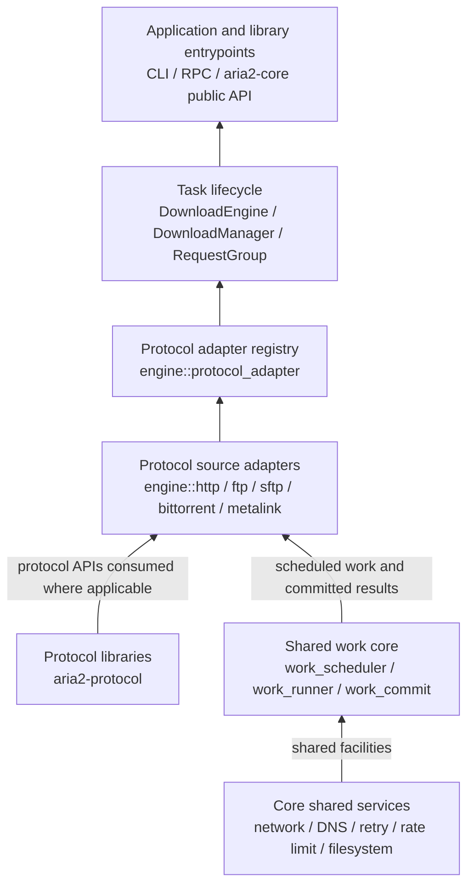

# Protocol Architecture

This document records where each protocol is implemented and how a download
travels from CLI/RPC input to network I/O. The structure follows ownership:
wire formats and reusable protocol clients live in `aria2-protocol`; task
policy and command execution live in `aria2-core`; CLI, RPC, and configuration
translation live in `aria2`.

## Layers, bottom to top



The diagram reads from foundation to application. Runtime calls go the other
way: CLI/RPC or a library caller adds a task; task lifecycle code starts a
tracked task, which asks `ProtocolAdapterRegistry` to select a registered
adapter. Each protocol adapter constructs its command and owns the protocol
setup it needs. The command supplies protocol-specific work items and request
rules to the shared work core. `WorkScheduler` owns generic queueing, bounded
admission, attempt counts, retry deadlines, and cancellation; `work_runner`
drives single-item attempts; `work_commit` enforces
validation-before-write-before-stable-persistence-before-checkpoint ordering
for complete work items. Adapters supply source requests, retry classification,
validation rules, and output/checkpoint handles. This keeps
transport and format policy with its source while the common work lifecycle is
independent of HTTP, FTP, SFTP, BitTorrent, or Metalink types.

The command registry and the work-item interface are separate seams. A new
protocol registers a command adapter and implements the shared work interfaces;
it does not add a branch to `task_spawner` or a protocol case to
`WorkScheduler`. HTTP/3 can use the same interfaces when its transport is added;
this change does not add an HTTP/3 network stack.

`aria2-protocol::http::HttpClient` and the standalone FTP client are public
protocol-library interfaces. The HTTP download engine uses its own reqwest
pool, network binding, redirect, cookie, retry, and task policies, so the
standalone HTTP client is not inserted as a redundant adapter in that route.

## Runtime request path

```text
CLI / RPC / library API
  → DownloadManager / DownloadEngine / RequestGroupMan
  → engine::task_spawner::spawn_download_task
  → engine::protocol_adapter::ProtocolAdapterRegistry
  → engine::<protocol>::command_adapter
  → protocol command
  → shared work scheduler / single-item runner
  → protocol source request and response
  → source validation → output write → stable-storage barrier → checkpoint
  → request/piece completion and task result
```

The Metalink adapter claims groups with Metalink source metadata before URI
dispatch. It expands metadata into payload request groups; each payload then
uses the adapter for its underlying route, such as HTTP, FTP, SFTP, or
BitTorrent. The built-in registry orders metadata and scheme-specific adapters
before the HTTP fallback. When SFTP is not compiled in, a small registry entry
still claims the `sftp:` scheme and returns `UnsupportedProtocol`; this keeps
core, RPC, and C API task creation from accidentally treating SFTP URIs as
HTTP. The CLI rejects the same unsupported protocol at input validation. The
HTTP adapter delegates construction to `engine::http::command_factory`, which
resolves target and proxy addresses.

Cargo feature propagation follows the same ownership boundary. BitTorrent,
Metalink, and SFTP are real optional features: the CLI forwards each to core and
protocol crates, and the protocol crate gates their module and optional
dependencies. HTTP and RPC remain compiled in every CLI tier; the CLI's `http`
and `rpc` features are tier markers, and `aria2-protocol/http` is a retained
marker because the protocol crate's HTTP API is unconditional. Therefore the
minimal artifact includes the RPC server just like standard; standard adds
BitTorrent, while TUI and full add their documented optional capabilities.

**Keep** `aria2_core::validation::protocol_detector::detect` in core as an
input-boundary classifier: it reads and sniffs local torrent/Metalink files
and returns the application-facing `InputType` used by CLI setup and metadata
expansion. It does not parse protocol wire data or construct network clients;
URI command selection remains with `ProtocolAdapterRegistry`. The separate
public `validation::uri::validate` helper is a shallow scheme/input check, not
the dispatch parser or the BitTorrent magnet parser. Both input checks accept
the `magnet:?` prefix case-insensitively and reject `magnet?`, matching the
protocol parser's URI boundary. Keeping these contracts separate avoids making
a local-file classifier depend on transport internals.

The process-level `OpenFileBudget` is a core filesystem service. The BitTorrent
adapter injects it into payload and magnet commands; Metalink injects the same
service into payload writers and torrent fallback. Multi-file BitTorrent block
and piece writes reserve the number of handles in each batch; resume reads and
seeding reads reserve one handle. A Metalink payload reserves one handle for
its output stream. `bt-max-open-files` is owned by the process engine: startup
sets the shared budget and runtime global-option changes update it through the
engine command path, so concurrent groups share one limit rather than
multiplying per-task limits.

## Shared work-item interface

`engine::work_scheduler::WorkScheduler<T>` is transport-neutral. A caller
queues typed payloads under opaque `WorkId`s, admits a bounded number of
leases, and reports completion, failure, or unstarted requeue. Retry budgets,
delayed work, cancellation, and active-lease validation live in that module.
`engine::work_runner::SingleWorkAdapter` uses the same scheduler for a single
logical item while allowing its adapter to classify source-specific errors and
wait interruptibly on task lifecycle changes.

`engine::work_commit::WorkCommitter` is for complete work items whose adapter
can define validation and persistence. Its order is received, validated,
written, durably persisted, then committed. `Committed` requires a successful
stable-storage barrier; a successful write into the operating-system page cache
alone is not persistence. Rust's `std::io::Write::flush` only drains writer
buffers. Both disk-writer interfaces now use `flush` only to drain software
buffers into the operating-system cache. `DiskWriter::sync_data` synchronizes
payload contents and the initial output path entry before advancing a sibling
checkpoint; `DiskWriter::sync_all` also synchronizes file metadata. Positioned
writers use the same `flush`/`sync_data`/`sync_all` distinction. On Unix the
namespace barrier
synchronizes the containing directory chain after syncing the file. On Windows
it opens and flushes the containing directory handle; unsupported directory
barriers return an error. BitTorrent multi-file setup also syncs the parent
entry for each directory it creates, from the deepest new directory upward;
this avoids relying on write access to unrelated pre-existing ancestors.
Checkpoint replacement uses `MoveFileExW` with
`MOVEFILE_WRITE_THROUGH` as its rename barrier. Checkpoint files are advanced
only after payload synchronization succeeds. When a new checkpoint is based
on an existing resume prefix, the engine first syncs that existing payload
and its path entry. `File::sync_data` may skip nonessential file metadata and
some platforms implement it as `sync_all`.

Validation is source-defined. HTTP status, Content-Range, offset, and expected
body-length checks establish protocol correctness, but do not claim
cryptographic integrity unless an explicit digest is available and verified.
BitTorrent complete pieces are committed only after their v1/v2 piece hash is
verified and payload data is durably synced. Received BitTorrent blocks are
staged and may be structurally checked, but are not called committed pieces.
HTTP range chunks are likewise intermediate writes; a range lease completes
only after its output has crossed the stable-storage barrier. Streaming
protocols use `SequentialWorkCommitter` and sync before advancing a resumable
checkpoint. These paths keep network and protocol decisions outside the
generic scheduler.

Scheduler transition tests use the synchronous `WorkScheduler<T>` directly,
injecting `Instant` values for retry deadlines. They require no network,
filesystem, Tokio runtime, or wall-clock sleeps. Fake commit adapters separately
verify that persistence failure cannot advance a checkpoint or report a commit.

HTTP range/mirror coordination and BitTorrent peer/piece selection retain
their domain policies. They choose which work items to offer and what source
rules apply; the shared scheduler owns lease lifecycle, attempt budgets, and
retry admission.

## Protocol routes

| Input | Core command path | Protocol implementation | Result path |
|---|---|---|---|
| HTTP/HTTPS | `ProtocolAdapterRegistry` → `engine::http::command_adapter` → `command_factory` → `download_command`; range probing and concurrent requests use `segment_downloader`, `concurrent_download`, and `request_executor`; sequential bodies use `sequential_download`. | `aria2-protocol::http` owns reusable HTTP response types, HTTP/1.1 request serialization and incremental response-header parsing, redirect URL resolution and shared origin/sensitive-header primitives, CONNECT negotiation over a caller-provided TCP stream, Content-Disposition parsing, Basic/Bearer/Digest authentication syntax and header generation, Cookie and Set-Cookie wire parsing and formatting, Retry-After value parsing, and Metalink/HTTP Link/Digest parsing. Core's public HTTP request/response structs map through the protocol request serializer and response-head parser while retaining their historical API shapes. The protocol crate also provides pure cookie syntax, date, default-path, and scope-matching primitives. `aria2-core::http` owns cookie-jar policy (acceptance, selection, expiry, persistence, and request attachment); its public cookie formatting entry points delegate wire serialization to protocol. Core also owns socket setup and outbound network policy, request/response task policy, credential resolution, filename destination policy, TLS identity, and client pools. Both HTTP and FTP CONNECT callers use the protocol handshake; each retains its own socket policy and preemptive-auth setting. `engine::http::client_config` composes options, DNS answers, proxy settings, and outbound-address policy into reqwest clients. The standalone `aria2-protocol::http::HttpClient` remains a separate public client and applies the shared redirect-origin rules in its own bounded redirect loop. | Range leases use `WorkScheduler`; chunks are intermediate writes, and completed ranges cross `sync_all` before scheduler completion. Sequential response checks establish HTTP protocol validity, not cryptographic integrity; file finalization and checkpoints use stable-storage barriers. HTTP mirror/range policy remains in the HTTP adapter. |
| FTP/FTPS | `ProtocolAdapterRegistry` → `engine::ftp::command_adapter` → `FtpDownloadCommand` → proxy GET or FTP control/data transfer. | `aria2-protocol::ftp::proxy` serializes FTP-over-HTTP-proxy GET requests; `aria2-protocol::ftp::connection::FtpControlSession` owns FTP command sequencing, response parsing, and path/passive-mode grammar over an injected control stream. `aria2-protocol::ftp::tls::FtpsClient` owns reusable TLS configuration, TLS handshakes, and RFC 4217 protection negotiation. For HTTP CONNECT, FTP supplies its policy-approved proxy stream and challenge-only auth setting to `aria2-protocol::http::connect`; core retains socket setup and error mapping. Core composes proxy selection, DNS/address policy, data sockets, active bind/accept policy, task lifecycle, filesystem state, and the process-scoped control-session pool. The pool retains the entire protocol session and its TLS/network context, keyed by origin credentials, proxy route, TLS policy, and outbound-source policy; only synchronized successful transfers return sessions to it. The standalone public `FtpDownload` API is not used by the engine; its mutable transfer buffer is bounded at the protocol use site. | `SingleWorkAdapter` supplies attempts; `SequentialWorkCommitter` writes chunks and syncs payload before advancing a checkpoint. Whole-file checksum policy uses the shared checksum service. |
| SFTP | `ProtocolAdapterRegistry` → `engine::sftp::command_adapter` → `SftpDownloadCommand` → shared `DnsCache` when `async-dns=true` / system DNS otherwise → `OutboundNetworkPolicy` TCP stream → `SshConnection::connect_with_stream` → `SftpSession` → `SftpFileOps`. | `aria2-protocol::sftp` owns SSH handshake/authentication, SFTP framing and request IDs, packet codec, and file operations. A cancelled in-flight request/response exchange poisons the shared session so late packets cannot be mistaken for a later operation; core discards the SSH connection on task cancellation. The adapter supplies URI/auth resolution and shared network services; the command keeps address attempts, retry classification, and task policy. | `SingleWorkAdapter` supplies attempts; source chunks use `SequentialWorkCommitter` for local writing, progress, and checkpoints. Payload is synced before checkpoint advancement. Whole-file checksum policy uses the shared checksum service. |
| BitTorrent | `ProtocolAdapterRegistry` → `engine::bittorrent::command_adapter`; torrent payloads use `download::command` → `download::execute`, while magnet input resolves metadata before the payload command. | `aria2-protocol::bittorrent` owns Bencode, torrent/magnet parsing, LPD announcement encoding/parsing, wire messages, TCP peer-listener bind/accept primitives, TCP plain/MSE peer handshakes, DHT (including `announce_peer` storage, peer lookup responses, and BEP 51 sampling), tracker announce URL classification and the `AnnounceList` tier/event state machine, UDP tracker URL syntax/default port, WebSocket tracker URL parsing/validation and handshake/framing/announce exchange, uTP packet/connection state machines, BitTorrent peer handshake/framing, and BEP 9 metadata piece collection. `PublicTrackerList` owns tracker-source catalog state, parsing, refresh scheduling, and health; it accepts an injected source fetcher. Core supplies the engine fetcher, which applies its DNS cache, outbound source-address policy, TLS options, scheme-specific HTTP/HTTPS proxies, proxy credentials, and `no-proxy` rules. HTTP tracker announces use the same option-aware proxy selection and bind through the selected proxy endpoint; the announce client cache separates direct requests from proxy routes and HTTP from HTTPS. Core owns announce timing and task lifecycle, selects event-eligible tiers, merges newly announced tiers, and applies transport/network policy. It also owns the process-level TCP/uTP listener manager, shared info-hash routes, address/port binding policy, handshake admission limits, connected-peer storage/admission, and async uTP socket actor. The core LPD adapter attaches the observed sender and applies local-address classification; the core uTP peer adapter bridges actor handles to the protocol `PeerTransport` interface and maps errors without parsing BitTorrent handshakes or frames. The adapter owns peer discovery, availability, rarity/endgame selection, and per-piece hashes. | Core `WorkScheduler` leases piece and WebSeed work. Received blocks are staged after layout checks and can be checkpointed only after their payload is synced. Complete pieces pass v1/v2 hash validation, then stable-storage sync, then live completion/checkpoint publication through `WorkCommitter`; BT-specific peer feedback and piece accounting remain in the adapter. |
| Metalink | `ProtocolAdapterRegistry` → `engine::metalink::command_adapter` → `MetalinkDownloadCommand`; parsing uses `aria2-protocol::metalink` and expands through `engine::metalink::to_request_group`. | `aria2-protocol::metalink` owns XML parsing, the parsed document/resource/hash model, URL-resolution and resource-ordering primitives, plus a standalone synchronous file-checksum utility. Core applies task options to file/resource selection and ordering, maps parsed BitTorrent resource URLs to torrent metaurls when that adapter is enabled and removes them otherwise, chooses mirror attempts, coordinates retries, and verifies whole-file/piece hashes through the shared checksum service. Each mirror and metadata URL is dispatched through a source-only registry to the ordinary HTTP, FTP, or feature-gated SFTP command. The parent injects shared DNS, outbound-address, and global-limiter services. HTTP mirror children keep one sequential request at a time and the Metalink 30-second default connect timeout. Child transfers write to a per-mirror staging path and relay progress/lifecycle; verified payloads are atomically promoted to the selected output path. Torrent MetaURLs still enter the BitTorrent command when that feature is enabled. | Source protocol commands own transport attempts, protocol-specific output/checkpoint behavior, and network options. Core's Metalink coordinator commits only after declared hashes pass. FTP/SFTP URI classification remains represented by the existing FTP resource enum for public API compatibility; the original URI scheme selects the actual adapter. |

### HTTP assembly and transfer path

1. `ProtocolAdapterRegistry` selects the HTTP adapter, which delegates
   command construction to `engine::http::command_factory`.
2. `command_factory` resolves the connection's first hop: the origin for
   a direct request, or the proxy endpoint for a proxied request. Async DNS
   uses the shared cache; with `async-dns=false`, a constrained source policy
   uses the system resolver only to choose a compatible local address. The
   selected addresses are supplied to reqwest and the outbound-address policy.
   The HTTP client also receives a per-task resolver so subsequent redirect
   hosts use the same async DNS cache or system resolver choice; resolved
   candidates are filtered through the outbound source-address policy.
   Core's `NoProxyMatcher` selects the first hop, and the reqwest proxy callback
   uses that same matcher so request routing cannot silently disagree with DNS
   resolution or source-address selection.
3. `download_command::constructor` calls `client_config` to build the primary
   reqwest client and range-client pool with the task's configured
   `connect-timeout`. The timeout participates in bound-client cache identity so
   tasks with different settings do not share an incompatible client. The
   command then owns request, auth, cookie,
   progress, and output-path state for the task.
4. `download_command::execute` prepares metadata and, when needed, probes Range
   support through `HttpSegmentDownloader::probe_range_metadata`. The probe
   returns the effective URL, entity length, and negotiated HTTP version.
   Core owns redirect-chain origin scope across metadata requests, probes,
   sequential retries, gaps, and concurrent ranges. A scheme, host, or
   effective-port change permanently removes origin credentials and
   conventional sensitive custom headers for that chain; cookie-jar selection
   remains URL-scoped, while proxy credentials follow proxy configuration and
   proxy challenges. The accepted Range Basic challenge cache is shared between
   the probe, concurrent request workers, and sequential gap fallback for that
   download, and each entry remains scoped by host, port, and path.
5. If concurrent ranges are allowed, `ConcurrentDownloader::execute_with_retry`
   selects its single-source scheduler or multi-mirror pipeline. Each path
   submits generic leases through `WorkScheduler`; `request_executor` runs
   `HttpSegmentDownloader` requests and sends offset-bearing response chunks
   to the HTTP output adapter. A range lease is completed only after `sync_all`
   succeeds; requested checkpoint saves use the same payload barrier. For
   multi-mirror resume, compatible in-flight records restore only each
   parent's leading contiguous run of durable 16 KiB blocks; gaps and
   incompatible records are fetched again.
6. Otherwise, or after concurrent fallback, `SequentialDownloader` streams the
   response after HTTP status and body checks. These checks are protocol
   validation, not cryptographic integrity validation. The output sink writes
   chunks and syncs before advancing control-file checkpoints; finalization
   establishes stable storage before task completion. Gap filling retains its
   range-specific planning and fallback behavior. `DownloadCommand` then
   finalizes the request group.

### FTP/FTPS assembly and transfer path

1. `ProtocolAdapterRegistry` selects `engine::ftp::command_adapter`, which
   creates `FtpDownloadCommand`. Its constructor parses the FTP URI and maps
   request options into task state.
2. `FtpDownloadCommand::execute` owns the request lifecycle, retry policy,
   address refresh, cancellation, and checkpoint cleanup. Each attempt enters
   `execute_single_attempt`.
3. An HTTP proxy configured for FTP can take the direct proxy-GET path. The
   protocol library serializes the FTP-specific absolute-form GET request; core
   selects the proxy mode, applies outbound policy, manages the response stream,
   and commits the body through the task writer. Other
   proxy requests establish an HTTP CONNECT tunnel through the protocol
   CONNECT session on the policy-approved socket; direct
   requests resolve origin addresses and connect through
   `OutboundNetworkPolicy`. Plain FTP, explicit FTPS, and implicit FTPS share
   `RawFtpControl`; both it and the standalone client pass their established
   control streams through `aria2-protocol::ftp::connection::FtpControlSession`,
   which owns FTP command semantics, command framing, and response parsing.
   FTPS upgrades and RFC 4217 negotiation use `aria2-protocol::ftp::tls::FtpsClient`;
   the client is created once per attempt and reuses its TLS connector for
   control and data channels.
4. The protocol session authenticates, selects TYPE, traverses the URI
   directory with PWD/CWD, and queries optional MDTM and SIZE metadata. Before
   RETR, core reconciles the remote size with the local file, continuation
   state, and checkpoint; dry-run and already-complete targets can finish here.
5. Core chooses PASV for an IPv4 control connection and EPSV for IPv6, matching
   aria2's FTP negotiation path. The protocol session owns each command and
   response and supports EPSV-to-PASV fallback; it negotiates EPRT/PORT for
   active mode, applies REST when resuming, and sends RETR. Core establishes the
   data socket under its outbound policy and asks the FTPS client to upgrade
   data TLS when configured. Active-mode listening and acceptance use the shared
   `FtpActiveDataListener`; the core still controls bind address and advertised
   endpoint selection.
6. `receive_data_transfer` passes source chunks through the core
   `SequentialWorkCommitter`, which writes through `DiskWriter`, updates request
   progress, and syncs payload before advancing the existing checkpoint. The HTTP proxy GET route
   uses the same committer. The command retains rate-limit setup, transfer-length
   policy, checksum configuration, and FTP completion handling.

`aria2-protocol::ftp::connection::FtpConnection` plus
`aria2-protocol::ftp::download::FtpDownload` is a separate standalone client
API over direct plain-TCP connections. The engine does not call it because its
task route must compose core address binding, HTTP proxy modes, FTPS, and
`RequestGroup` lifecycle behavior. Both interfaces are kept at their own
boundaries; the standalone client is not an adapter around the engine command.
Standalone and injected FTP connections share one RFC 959 response parser;
the standalone API maps typed parser failures to its existing string error
surface.
The standalone in-memory download caps eager capacity reservation at 1 MiB
because FTP `SIZE` is server-controlled; its result buffer can still grow with
the received payload.
The shared FTP control writer rejects CR/LF inside a command, and recursive
standalone downloads accept only single-component names from server listings
when deriving local child paths. The injected control session uses the same
writer, so this command-framing guard also covers the core FTP route. FTP
connection paths omit `USER` and `PASS` arguments from command diagnostics.

### SFTP assembly and transfer path

1. `ProtocolAdapterRegistry` selects `engine::sftp::command_adapter`, which
   creates `SftpDownloadCommand` and injects the process outbound-network
   policy and global rate limiter.
2. The command parses the SFTP URI, resolves credentials and output state, and
   builds SSH options including the configured host-key fingerprint policy.
3. The engine asks `OutboundNetworkPolicy` to create the target TCP stream and
   applies `sftp-connect-timeout` across that connection and
   `SshConnection::connect_with_stream`. Core also races DNS, TCP, SSH,
   SFTP session initialization, and the initial remote `stat/open` operations
   against request-group lifecycle notifications; pause, remove, and halt
   therefore cancel setup without waiting for a network read timeout. The protocol
   module owns the SSH handshake, host-key check against the configured
   fingerprint or OpenSSH-format `known_hosts`, authentication, and subsystem
   channel. It preserves host-key verification failures through russh's
   handshake callback as non-retryable configuration errors; ordinary TCP
   connect failures retain retryable transport classification. `AcceptNew`
   records only previously unseen host keys and rejects later changes;
   `Strict` rejects unknown keys. Its separate
   `SshConnection::connect` entry point is for standalone direct TCP use.
4. `SftpSession::open` sends INIT v3 and accepts the negotiated v3 response,
   matching the versions implemented by the current packet codec. The session
   owns packet reads/writes, request IDs, serialized request/response exchanges,
   response-ID validation, operation counts, and one absolute read deadline per
   packet, including fragmented packets. It reports typed
   `SftpSessionError` values for SSH, packet, channel, timeout, and correlation
   failures. `SftpFileOps` translates filesystem status packets into
   `FileOpError` and preserves session errors as sources; `SftpRemoteFile`
   provides positioned reads/writes and explicit handle closure with the same
   file-operation error type. `SftpDownloadReader` owns read-only OPEN, bounded
   sequential READs, offset advancement, advertised-size enforcement, and
   premature-EOF detection; it is shared by standalone and core downloads. The
   core retries only errors classified by the protocol layer as connectivity
   or timeout failures; protocol violations and unclassified remote statuses
   terminate the attempt.
5. The engine stats the remote file, reconciles the local length and checkpoint,
   and supplies the chosen resume offset to `SftpDownloadReader`. It passes each
   returned chunk through the core `SequentialWorkCommitter` for local writing
   and progress; the payload is synced before checkpoint updates and final
   checksum verification/task completion. A non-terminal control-file-save
   notification keeps the current read future alive; pause, removal, and halt
   cancel it and discard the SSH connection so a late SFTP response cannot
   desynchronize a later request.

Keep `SftpDownloadCommand` as the engine-level coordinator. It calls the
protocol library's typed `SftpSession`, `SftpFileOps`, and
`SftpDownloadReader` interfaces. Core retains request-group lifecycle,
resume/checkpoint policy, rate-limited `DiskWriter`, retry classification, and
task errors; the protocol reader owns remote OPEN/READ offset and size rules,
and handle closure. Keep core output and checkpoint policy out of the protocol
crate, and avoid duplicating the sequential READ loop in core.

**Keep** SFTP option definitions and source-precedence policy in core, where
CLI/config, RPC, C API, and session restoration converge. **Narrow** their
registration into `config::option_definitions::sftp`; the definitions keep
their existing public option names and `http/ftp` help category, while defaults
come from protocol-owned constants. `SftpDownloadCommand::build_ssh_options`
is the single conversion from normalized `DownloadOptions` into protocol
`SshOptions`. The definitions remain registered in every build for consistent
diagnostics, but their supported flag and runtime-option availability follow
the core `sftp` feature. A build without SFTP rejects explicit CLI/config and
task-option values; global runtime-change adapters ignore them under the
existing non-changeable-option contract and do not store or dispatch them.

**Keep** BitTorrent option definitions in core because they configure engine
policy and are consumed by CLI/config, RPC, C API, and session boundaries.
**Narrow** the registry implementation: `register_bt_options` remains the
single feature-gated entry point and delegates tracker, DHT, and peer-network
definitions to private child modules. These are registry organization seams;
the external option names, values, categories, and registration availability
remain unchanged.

**Keep** piece selection and endgame policy in the BitTorrent engine. The
registered `bt-piece-selection-strategy` and `bt-endgame-threshold` options
flow from CLI/config, RPC, C API, and session restoration into
`DownloadOptions`; `PieceDownloadSession` configures both `PiecePicker` and
`BtPieceSelector` with the same strategy and threshold. Zero disables endgame.
These settings are Rust extensions and remain separate from protocol wire
message parsing.

`aria2-protocol::sftp::transfer::SftpTransfer` remains a public standalone
transfer interface. It adds local-file I/O, configurable buffering, resume,
progress callbacks, and optional source permission and timestamp preservation
over `SftpFileOps`.
It returns typed `TransferError` values with the original SFTP or local I/O
error preserved as a source. Resume inspection treats only an explicit
not-found response as unsupported; transport and permission failures propagate.
The engine does not call it because the engine path must write through its
`DiskWriter` and `RequestGroup` checkpoint lifecycle.

HTTP trackers, UDP trackers, WebSeeds, and DHT remain under BitTorrent because
their retry, announce, peer, lookup, and piece semantics are BitTorrent
behavior. UDP tracker framing and packet codecs live in
`aria2-protocol::bittorrent::tracker`; core resolves tracker addresses through
`OutboundNetworkPolicy` and binds the UDP socket; the protocol UDP tracker
client owns CONNECT/ANNOUNCE/SCRAPE transactions, connection-ID reuse, and
retries. Core owns announce lifecycle. DHT wire and lookup primitives live in
`aria2-protocol::bittorrent`; torrent-scoped lookup scheduling and process
ownership live in `aria2-core::engine::bittorrent`.
HTTP tracker requests use reqwest. The engine applies HTTP/HTTPS proxy,
`all-proxy`, credentials, and `no-proxy` options to both announces and public
tracker-list requests; outbound source selection targets the configured proxy
when one is active. Under direct routing, the request client owns DNS. Host
resolution is needed for source-family matching only when an explicit outbound
address/interface is configured; pre-resolving in direct mode can reject an
announce before the HTTP client starts it.
Local Peer Discovery is composed across the protocol and engine layers:
`aria2-protocol::bittorrent::lpd` encodes and parses BEP 14 and the legacy
announcement format; core owns the multicast socket, receive loop, sender-address
classification, peer-registry updates, and torrent-activity lifecycle under
`engine::bittorrent::discovery::lpd`.

### BitTorrent assembly and transfer path

1. `ProtocolAdapterRegistry` selects `engine::bittorrent::command_adapter` for
   existing torrent metadata, a `bt://` request, or a `magnet:` URI. It routes
   payloads to `BtDownloadCommand` and magnets to `MagnetDownloadCommand`.
2. `MagnetDownloadCommand` parses the URI once through the protocol library's
   `MagnetLink` parser during construction and retains the typed value for
   output naming and execution. It resolves metadata in this order: a saved
   torrent when enabled, an `xs` exact source, tracker-discovered peers, then
   DHT-discovered peers and BEP 9 metadata exchange. `metadata_source`
   coordinates those sources; `discovery` owns tracker/DHT peer lookup; core
   `metadata` owns saved files and info-hash checks.
   `aria2-protocol::bittorrent::torrent::metainfo` owns
   the pure bencode transformations that wrap BEP 9 info dictionaries and
   merge magnet WebSeeds into torrent metainfo. Protocol `MetadataCollector`
   validates piece boundaries and assembles BEP 9 metadata; core owns peer
   selection, retry limits, and exchange lifecycle.
3. Before payload transfer, the command enforces the private-torrent DHT rule,
   optionally saves the complete torrent metadata, and completes immediately
   for metadata-only requests. Otherwise it constructs `BtDownloadCommand`
   with the existing `RequestGroup`, the resolved torrent bytes, and the
   outbound-network policy. Any DHT engines acquired for metadata discovery
   are handed to that command so the payload stage can reuse them.
   The magnet coordinator awaits the nested `BtDownloadCommand::shutdown` on
   both success and failure. The outer task spawner only owns the magnet
   command, so it cannot clean up the nested command; this await persists a
   locally owned DHT engine and releases task-scoped resources while the
   command's shared-engine check keeps process DHT alive.
   At final engine shutdown, the registry drains both global and per-GID DHT
   handles and deduplicates shared `Arc`s before asynchronous shutdown. This
   also persists engines retained by a task that exceeded the graceful-shutdown
   deadline and was aborted before its per-GID cleanup ran.
   For payload downloads, the validated, normalized metainfo is also retained
   on that same group before handoff. Session snapshots encode it in the
   existing `aria2-rust-bt-metadata-data` field, allowing a restored magnet task
   to start directly from its metainfo without needing the original `xs`
   source or repeating BEP 9 discovery. Metadata-only requests complete before
   this payload-resume snapshot is installed.
4. `BtDownloadCommand::execute` prepares the torrent layout and integrity
   state, then coordinates tracker/DHT discovery, peer sessions, piece
   selection, and WebSeeds through `download::execute`. The piece source uses
   the core `WorkScheduler` for work leases. Received blocks are staged after
   layout checks; their in-flight checkpoint bits are published only after
   payload sync. Complete pieces pass their v1/v2 hash validator, are written
   and synced, then become live-complete and eligible for checkpoint publication
   through `WorkCommitter`.
   The protocol crate's `bittorrent::web_seed::WebSeedHttpClient` constructs
   BEP 17/19 byte-range requests, accepts the established 200/206 response
   behavior, and bounds response-body reads. Core configures and injects the
   HTTP client with its TLS and outbound-network policy, then owns URI fallback,
   availability, statistics, and task-progress updates.
   Peer wire messages, TCP peer protocol, torrent-geometry and negotiated-
   capability validation, and per-peer protocol-session state use
   `aria2-protocol::bittorrent`;
   core owns peer selection, outbound network policy, and the process uTP actor.
   Core maps invalid frames, capability violations, and torrent-geometry
   violations to recoverable peer failures so the owning actor disconnects the
   offending connection; they are not reported as local configuration errors.
   Bad-peer feedback remains BitTorrent-specific engine policy.
5. Peer interaction selects uTP, MSE, or a plain TCP fallback from task
   settings. For TCP, core establishes the policy-approved stream and passes it
   to the protocol crate's plain or MSE handshake; both return the same
   `PeerConnection`, which owns message framing and applies MSE encryption when
   negotiated. For uTP, core owns the process transport actor and adapts its
   byte stream to protocol `PeerWireSession`, which owns the handshake and
   message framing. Protocol `PeerState` tracks choke/interest/request state,
   while `PeerSessionResource` tracks torrent geometry, availability, and
   negotiated extensions. `BtPeerConn` then adds engine peer identity, upload
   policy state, and statistics. Once
   initialized, it is moved into a long-lived `PeerActor`; that actor is the
   sole runtime owner of the connection and performs its socket reads/writes.
   Coordinators send peer commands and consume peer events rather than doing
   parallel socket I/O. `BtPeerConn` therefore remains the actor-owned
   connection/state object at runtime; only pre-actor ownership is temporary.
   Dial concurrency is scoped by workflow: initial swarm admission is limited
   by available `bt-max-peers` slots and the selected peer list, then attempts
   those candidates concurrently and settles for one second after the first
   success. Magnet metadata admission is bounded by its candidate/peer limits;
   seeding batches are capped at 32 candidates. Later tracker, DHT, and PEX
   discovery uses `PeerDialQueue`, which retains at most 512 unique pending
   endpoints and dials at most 10 candidates from one source at a time. These
   are separate core policies, not one protocol-library connection limit. All
   TCP paths still establish sockets through `OutboundNetworkPolicy` before
   passing them to protocol handshake APIs; dropping the owning batch cancels
   unfinished handshakes and closes their streams. Initial admission returns
   checked-out peers that did not become active; the seeding manager likewise
   returns unadmitted peers after a batch and aborts/joins its pending batch
   before returning all checked-out peers on shutdown. Discovery-queue
   candidates remain queue-owned until selected, and its `JoinSet` aborts the
   active batch when the piece session exits.
   BEP 11 payload encoding, compact-address conversion, and message framing use
   protocol types; core selects, filters, and schedules the peers to advertise.
   The torrent-scoped `TorrentSession` owns the `PeerSwarm`, which the
   piece-download coordinator borrows and then transfers into seeding. Magnet
   metadata actors are activated for payload in place, preserving the same
   connections and registry across that transition.
   Incoming TCP follows the same boundary: core accepts under its shared
   handshake limit and snapshots the live info-hash routes and their MSE
   policies; protocol `incoming::receive_with_options` parses and negotiates
   the handshake, then exposes the parsed info-hash (MSE checks its candidate
   against the supplied route set). Core selects the
   current route, asks the protocol result to complete the local handshake,
   and applies peer-storage/mailbox admission without reparsing wire bytes.
   Routes are installed before initial peer discovery; core refreshes their
   address-family-specific DHT capability bits after the DHT engines are
   started or joined, so later TCP and uTP handshakes advertise the active
   family capability.
6. `TrackerAnnouncer` selects one tracker URL from `BtAnnounce`; core resolves
   UDP addresses and binds a socket under the outbound-network policy, then
   passes that socket to the protocol `UdpTrackerClient`. Protocol owns the
   BEP 15 CONNECT/ANNOUNCE/SCRAPE transaction state, connection-ID cache,
   transaction matching, retries, and codecs. Protocol `AnnounceList` manages
   tier order and failure rotation; core `TrackerAnnouncer` manages task
   lifecycle, transport selection, and engine error classification.
   If a bencoded HTTP tracker response includes an `announce-list` field, the
   client treats it as an additional tracker extension and appends unseen
   tiers without replacing configured primary tiers; the actor's separate
   public-tracker fan-out remains independent. A later primary failure can
   select the added tiers. This is a Rust extension: upstream aria2's
   response handler does not consume that field, and BEP 15's fixed binary UDP
   announce response has no URL-list field.
7. The process-level `BtPeerListenerManager` owns uTP transport actors keyed by
   local endpoint. It passes the configured `UtpSocketOptions` to each new
   socket; CLI, global RPC updates, and the C API all update this process-level
   configuration. Existing actors retain the options they were created with
   because each socket is shared across torrent routes. If an actor exits,
   existing peer handles fail and may fall back to TCP; a later registration
   reaps the stopped actor and creates a fresh one for that endpoint.
8. `PublicTrackerList` owns remote source-list fetching, its complete response
   deadline, and catalog state. It caps decoded source bodies at 8 MiB and
   accepts at most 4096 unique valid tracker entries per source. Its source
   fetcher is injectable so
   the engine can apply the shared DNS cache, source-address policy, and TLS
   configuration, plus configured HTTP/HTTPS proxy routing and credentials.
   Standalone protocol callers retain the default reqwest fetcher. The
   protocol library exposes the timeout separately from `TrackerCatalogConfig`,
   preserving that public struct's existing construction API. Core owns
   CLI/RPC/C API translation and sends runtime updates to the catalog.
   `bt-tracker-source`, `bt-tracker-update-interval`, and
   `enable-public-trackers` configure this engine-owned, process-shared catalog;
   the per-download `bt-tracker` option remains task-owned. An active source
   fetch keeps its captured deadline.

### DHT inbound query path

The DHT engine is assembled from the UDP socket, routing table, KRPC services,
and bounded lookup scheduler. `engine/startup.rs::DhtEngine::start` loads the
family-specific state, binds the socket, builds the shared engine context, then
starts the inbound loop in `engine/receive.rs` and maintenance loops in
`engine_inner.rs`. `engine/api.rs` exposes peer lookup, announce, and BEP 44/51
operations; `engine/lifecycle.rs` owns bootstrap state, shutdown, and statistics.
`RoutingTable` owns node admission and health queries; `Bucket` owns node
membership and replacement candidates; `DhtNode` records responsiveness; the
private `bucket_tree` module owns bucket splitting and tree traversal.

`DownloadEngine::from_process_options` captures process DHT settings as
`DhtEngineOptions` when it configures BitTorrent process services;
`DownloadEngine::new` supplies the default process settings. Rust library
callers that need custom shared DHT settings use `from_process_options`. The
per-torrent commands still use
their own `enable-dht` and `enable-dht6` values to decide which family to join,
but a task override cannot configure the shared process engine. This matters
because `BtRegistry` owns at most one DHT engine per address family: otherwise
the first torrent to start DHT would silently choose the process-wide port,
bootstrap nodes, persistence path, and timing settings.
Core resolves explicitly configured bootstrap endpoints before startup. When
none are configured, the protocol DHT engine resolves its built-in public
bootstrap list asynchronously during background bootstrap.

Core translates the process outbound-network policy into the DHT socket's
family-specific bind address before creating the protocol engine. Under a
constrained policy, it skips a family with no compatible source and rejects a
conflicting explicit DHT listen address; only direct routing may use a wildcard
bind. The protocol engine owns the bound UDP socket and all subsequent DHT
traffic. Listener, bootstrap, persistence, and timing settings configure the
shared engine at startup and are excluded from both runtime option allowlists.
The Rust resource limits `dht-max-peer-info-hashes`,
`dht-max-peers-per-info-hash`, and `dht-max-items` are process-owned extensions:
`changeGlobalOption` updates running storage and future engine configuration;
task `changeOption` cannot override them.

`DhtEngineContext` stores one `DhtTaskContext` for the effective local node ID,
routing table, UDP socket, transaction tracker, and query timeout used at
runtime. Startup copies the configured timeout into that context. `DhtEngineInner`
stores only mutable lifecycle state, so direct engine calls, background loops,
and scheduled tasks share the same protocol resources.

1. `DhtSocket` is the sole UDP reader. `engine/receive.rs` distributes datagrams
   round-robin through bounded worker queues, skips full or closed workers, and
   drops a packet only when no queue accepts it. The KRPC decoder accepts only
   exact `y` values (`q`, `r`, or `e`), requires response dictionaries to carry
   a 20-byte node ID, and validates the two-field error shape. Invalid messages
   are dropped before they reach shared state. It consumes the first complete
   bencoded value and ignores trailing datagram bytes, matching upstream
   `BencodeParser::parseFinal`, which stops when the top-level value completes.
   The low-level compact-node record parser keeps complete records before an
   incomplete tail; response extraction ignores a field whose total length
   does not identify an address family. Upstream rejects a node field whose
   length is not an exact record multiple. This malformed-input behavior is
   recorded in the compatibility status.
   Responses and errors go to the
   transaction tracker. Unknown transactions and replies from the wrong source
   are ignored; a valid KRPC error closes its matched waiter as a failure so the
   querying task updates node health through the same path as a timeout.
   Queries enter `DhtQueryHandler`. Shutdown closes queue senders, drains
   pending packets for up to 100 ms, then aborts workers that are still blocked.
2. The handler validates the query method and sender node ID, ignores packets
   from the local node, then dispatches `ping`, `find_node`, `get_peers`, and
   `announce_peer` to the BEP 5 handlers. `items` owns BEP 44 `get`/`put`, and
   `sample` owns BEP 51 `sample_infohashes`; sampling depends on peer storage,
   not on the optional BEP 44 item store. `TokenTracker` binds announce tokens
   to the info hash and requester IP (not its transient UDP port) and uses a
   random 256-bit process-local secret. Its four-byte deterministic constructor
   is retained for compatibility; production engine startup uses `new()`. BEP
   44 `get` replies use the address-family-appropriate compact node field, and
   include both address-family fields. Malformed optional `seq`/`cas` values
   are rejected at the handler boundary; CAS is ignored when no item exists.
   Inbound responses use `RoutingTable::find_closest_good`; local lookups keep
   using `find_closest` so unverified restored/discovered nodes can be probed.
3. `HandleResult` carries the response and an optional sender ID eligible for
   promotion. The engine releases the routing-table and token locks, sends the
   response, then promotes an accepted sender into the routing table.

### DHT background maintenance path

1. `engine_inner.rs::spawn_periodic_tasks` owns the maintenance timers and
   submits work to the bounded `DhtTaskQueue`; it does not perform network or
   persistence work in the timer loop. Token rotation is the synchronous
   exception and updates the token tracker directly.
2. Bucket refresh runs in periodic lane 1 through `BucketRefreshTask`.
   Node contact and cleanup run in periodic lane 2 through `MaintenanceTask`:
   contact selects one good node per bucket and issues bounded `PingTask`s;
   cleanup expires peer and transaction state, then evicts bad nodes and
   attempts cached replacements. These network-maintenance ticks are skipped
   while lane 2 is busy, preventing overlapping stale work.
3. Routing-table saves use the same lane but are queued even when it is busy.
   `MaintenanceTask` is the adapter required by the shared `DhtTask` queue;
   its variants each perform a distinct engine operation. The public
   `save_state` and `evict_nodes` methods call those same operations directly
   for on-demand requests.

### DHT persistence path

1. `engine/startup.rs::DhtEngine::start` reads the configured family-specific
   snapshot, accepts it only within `persistence_max_age`, and inserts restored
   nodes as unverified routing candidates.
2. Periodic saves, `save_state`, and shutdown all call
   `DhtEngineContext::save_state`. Shutdown first stops queued and background
   work, then reuses this method. It collects current good nodes;
   `DhtPersistence` serializes that single snapshot and atomically replaces the
   file under its cross-process file lock. Expired or evicted nodes are not
   merged back from an older snapshot.
3. The BEP 44 item store uses its own `.items` file and serialization format.
   Its synchronous write uses the same DHT atomic-file primitive as the routing
   snapshot: a per-path cross-process lock, a synced temporary file, atomic
   replacement, and a parent-directory sync where supported. Both file writes
   run outside the async runtime and are attempted independently; one write
   failure does not suppress the other, and the shared method reports either
   or both errors. Startup reads the item file asynchronously and runs bencode
   decoding and signature checks on the blocking pool, matching the routing
   snapshot's non-blocking startup path.

Magnet is a metadata-resolution stage, not a second payload downloader. Both
magnet and `.torrent` inputs converge on the same `BtDownloadCommand` and piece
execution path. The command's implementation is split by its actual internal
roles under `magnet/download_command/`; those modules are private and do not
add another task-facing interface.

## Ownership rules

- `aria2-protocol/src/{http,ftp,sftp,bittorrent,metalink}` is the lower
  protocol-library layer. A protocol module owns its wire representation and
  reusable protocol-specific operations; it does not depend on `aria2-core`.
- `aria2-core/src/engine/{http,ftp,sftp,bittorrent,metalink}` owns protocol
  commands and behavior that depends on request groups, storage, retries,
  scheduling, or process-wide state. Protocol-specific code stays in its
  protocol directory.
- `aria2-core/src/engine` keeps cross-protocol work: task lifecycle, dispatch,
  work scheduling/running/commit, checkpoints, and engine services. HTTP
  range/mirror planners remain HTTP domain policy even though their existing
  public modules are rooted under `engine`. The HTTP-only cookie helper,
  concurrent downloader, range-probe path, and sequential downloader live under
  `engine/http`; protocol-specific work does not remain at engine root just
  because it is shared by HTTP transfer strategies. HTTP target/proxy DNS resolution is owned by
  `engine/http/command_factory`, and reqwest client construction is owned by
  `engine/http/client_config`.
- `aria2-core/src/dns` owns the process resolver cache and name-resolution
  fallback. On paths that opt into async DNS, `async-dns-server` replaces
  system DNS servers; a failed explicit lookup does not fall through to the
  system resolver. With no explicit server list, Hickory uses system resolver
  configuration and may fall back to Tokio's system lookup within the shared
  DNS deadline. Cloned `DnsCache` handles share positive/negative entries and
  per-endpoint lookup flights. Cache-state locks are held only for synchronous
  map operations; DNS I/O runs outside them, while same-endpoint misses
  coalesce and unrelated endpoints can resolve concurrently. Paths with
  `async-dns=false` use system DNS resolution.
- `aria2-core/src/{http,ftp,network}` owns shared core policy and helpers used
  by the engine. These directories are distinct from the similarly named
  engine directories: the former implement reusable policy; the latter
  assemble that policy into a download command.
- `aria2-core` crate-root exports remain the supported application library
  surface. The engine directory layout is an implementation seam; applications
  should use the task-facing types re-exported from `aria2_core`.

The standalone `aria2-protocol::http::HttpClient` and FTP client APIs have their
own public library interfaces and direct tests. The active FTP task route uses
the task command described above; the protocol crate's standalone
`FtpConnection`/`FtpDownload` remains a distinct external client API. The core
also exposes `aria2-core::http::connection`, `aria2-core::ftp::connection`, and
`aria2-core::ftp::connection_pool` as public library interfaces. These APIs
remain at their existing boundaries: the HTTP task path composes reqwest with
pooling, address binding, request policy, and task lifecycle, while the FTP
task path composes its control/data flow with core network policy and
protocol-layer FTP/FTPS behavior.
Do not add pass-through engine clients around these public interfaces.

## Module audit

### Finite audit scope and coverage

This audit covers protocol execution and its configuration/lifecycle path in
`aria2-protocol`, `aria2-core`, `aria2`, and `aria2-rpc`. It is not a general
line-by-line audit of every workspace crate. Stop this audit when every row
marked **Open** has a concrete module/contract checklist completed, its result
recorded here or in `compatibility-status.md`, and focused validation recorded.
Reopen a completed row only when a code change, regression, or new evidence
touches it.

| Area | Coverage | Remaining finite work |
| --- | --- | --- |
| Protocol routing and ownership | HTTP, FTP/FTPS, SFTP, BitTorrent, Metalink, and magnet routes are described above; module decisions are recorded below. | None for route ownership. |
| Protocol-library public interfaces | Root exports are fixed to `http`, `ftp`, `bittorrent`, `metalink`, `sftp`, `socks`, `proxy`, `uri`, and `identity`. The last four are reviewed below. HTTP's fifteen, FTP's six, SFTP's six, Metalink's three, and BitTorrent's 13 public root modules (including their recursively exported public children) have ownership decisions and error/resource contracts recorded below. | None for protocol-library public interfaces. Private modules are excluded; completed groups close permanently unless touched by new evidence. |
| Core execution and lifecycle | The six routes and all four cases are cross-checked in the finite matrix below. Existing implementation and focused-test locations are recorded per route. | No internal audit work remains. Run focused behavior suites when verification is requested; live original-aria2/server interoperability remains the separate external evidence gap. Reopen only after a code change, regression, or new evidence. |
| Configuration propagation | **Covered** for protocol/task settings: all 165 initial request options are checked across config parsing, CLI parsing, RPC conversion, typed task state, and session serialization; all task runtime-policy entries are checked against typed consumers; all 103 protocol/shared CLI task options have a Clap argument and `load_cli_args` mapping. RPC and C API task changes converge on `RequestGroupMan`; global changes share core policy and the same engine-command projector. `uri-selector` now reaches HTTP multi-mirror assembly. | None for this row. Reopen only if option definitions, adapters, or these contract tests change. |
| Bindings and packaging | C API process setup has a focused compatibility section. | Python/Node binding pass-through and feature/package surfaces are outside this protocol runtime audit; do not block this audit unless they expose protocol options or public protocol APIs. |
| External interoperability | Upstream source/docs and focused fixtures are recorded per behavior. | Live original-aria2 cross-binary tests remain unavailable; this is a verification gap, not a reason to repeat completed source audits. |

The audit is not reopened merely to reread already classified modules. An open
row closes with source/caller evidence, a Keep/Narrow/Delete/Improve decision
where applicable, and focused validation or an explicit external evidence gap.
The protocol-library public-interface row has exactly nine root module groups;
new private helpers do not expand that inventory. Feature-gated groups are
audited with their feature enabled.

#### Core execution lifecycle matrix

Each cell below points to the owning path and existing focused regression
coverage; it records audit coverage, not a claim that those tests ran in this
turn. The four columns are the complete checklist for each route.

| Route | Setup/protocol failure | Cancellation/shutdown | Retry/reconnect | Resource release/persistence |
| --- | --- | --- | --- | --- |
| HTTP/HTTPS | `engine/http/segment_downloader/downloader/tests` | `engine/http/concurrent_download/segment/cancel.rs`; `engine/http/download_command/lifecycle.rs` | `engine/http/segment_downloader/downloader/tests/retry_after.rs`; `engine/http/concurrent_download` retry paths | `engine/http/sequential_download/checkpoint_tests.rs`; `engine/http/concurrent_download/segment/resume.rs`; shared `engine/work_commit.rs` |
| FTP/FTPS | `engine/ftp/download_command/tests/configuration.rs`; `tests/transfer.rs` | `engine/ftp/download_command/tests/lifecycle.rs` | `engine/ftp/download_command/attempt.rs`; `tests/lifecycle.rs` | `SequentialWorkCommitter` in `engine/work_runner`; FTP checkpoint and cleanup decisions in `compatibility-status.md`'s FTP sections |
| SFTP | `engine/sftp/download_command/tests.rs` (host-key, protocol, and error classification) | `engine/sftp/download_command/execution.rs`; removal-interruptible retry case in `tests.rs` | `tests.rs` transient-network and total-attempt cases | resume-offset cases in `tests.rs`; explicit remote-handle close and synced local checkpoint path in the SFTP route above |
| Metalink mirror/metadata children | `engine/metalink/download_command/execution/tests.rs` (mirror status and metadata parsing) | slow metadata pause case in the same test module; staged-file removal/halt semantics in `compatibility-status.md` → “Metalink parsed execution data” | 504 mirror and torrent-metaurl retry cases in the same test module | staged-file promotion and pause/resume/removal checkpoint cases in “Metalink parsed execution data” |
| BitTorrent payload | `engine/bittorrent/peer` message validation; `engine/bittorrent/download/execute` piece validation/commit path | peer actors, WebSeed tasks, tracker stop, and piece-session shutdown paths in the BitTorrent route above | `engine/work_scheduler/tests.rs`; BitTorrent piece requeue and tracker retry paths | `engine/bittorrent/download/execute/piece_download/session/{piece_completion,lifecycle}.rs`; checkpoint persistence path above |
| Magnet metadata discovery | `engine/bittorrent/magnet/download_command/tests/{discovery,metadata}.rs` | magnet command awaits nested payload shutdown; discovery actors and cancellation paths in `magnet/download_command.rs` | tracker/DHT source progression and metadata peer retry limits in `magnet/{download_command,metadata_exchange}.rs` | saved metadata/info-hash checks and restored metainfo snapshot in the BitTorrent route above; task-scoped DHT shutdown/persistence there |

The matrix closes internal route/lifecycle auditing. The remaining gaps are
external interoperability (live original-aria2 and remote FTP/FTPS/SFTP servers)
and execution of the cited focused behavior suites when requested; neither
requires repeating the completed module audit.

HTTP's `http/mod.rs` has fifteen public child modules, all reviewed with
source/caller evidence and ownership decisions below. Parsers and serializers
return values or typed/string errors without owning sockets; `HttpResponseStream`
owns its response body and dropping it cancels the read; CONNECT operates on a
caller-owned stream; stateful body filters report parse, I/O, or protocol errors
and own no external resources. The whole-buffer encoding helpers remain a
separate public compatibility interface. Core remains responsible for cookie
policy, proxy routing, task retries, and response lifecycle.

FTP's `ftp/mod.rs` exports six child modules. The URI, listing, and proxy
helpers are pure parsers/serializers; FTP control I/O is bounded and reports
framing/transport failures; `FtpControlSession` operates on an injected stream;
FTPS upgrades transfer caller-owned streams; the standalone `FtpDownload`
owns its transfer loop and cancellation cleanup. The engine uses protocol FTP
control-session, TLS, URI, and proxy primitives, while the standalone
`FtpConnection`/`FtpDownload` remain independently public and have no engine
callers. Their resume, completion, cleanup, and allocation contracts are
recorded in `compatibility-status.md`. Live remote FTP/FTPS interoperability
remains the explicit external evidence gap.

SFTP's `sftp/mod.rs` exports six child modules. The engine call graph uses the
protocol URI, SSH connection, SFTP session, file operations, and bounded
download reader; packet codecs provide the shared wire implementation.
`SftpPacket::decode` enforces the 16 MiB frame ceiling and exact packet
consumption. Session and file-operation failures remain typed by layer, and
remote handles require explicit asynchronous close because `Drop` cannot send
SFTP requests. The standalone transfer interface remains public; upload and
download close, resume, cancellation, and read-validation behavior are
recorded below. Validation is feature-gated; live remote-server
interoperability remains the explicit external evidence gap.

Metalink's `metalink/mod.rs` exports three child modules. Core uses the XML
document/model parser and resource classification during source expansion;
selection, URL resolution, and ordering remain pure model operations. The
standalone checksum verifier has no production workspace caller and remains a
public library utility, while active engine verification uses core's shared
checksum service. Parser failures are returned to the caller as `String`
errors; the protocol parser owns no file handles, network requests, or task
lifecycle. Metalink module ownership, parse-once expansion, and staged-output
verification are recorded above and in `compatibility-status.md`.

BitTorrent's `bittorrent/mod.rs` exports thirteen public root modules; their
public interfaces and descendants are classified in this section. The
extension modules own MSE handshake/crypto and PEX wire parsing; core consumes
PEX candidates and retains peer admission. The public metadata-request tracker
has no production workspace caller and remains a standalone utility whose
caller coordinates `avail` and `add`. BEP 6 fast-set generation is a pure,
deterministic helper; engine callers cap its requested set at ten. The
protocol `piece::bitfield::Bitfield` is the shared compact representation used
by core's availability tracker; core validates each peer bitfield against
torrent geometry before applying it. These three module contracts, including
MSE diagnostic redaction, are recorded in the decisions below.

- **Keep** the protocol-library folders and their codecs, clients, parsers,
  and transport-specific state. They provide independently usable protocol
  behavior.
- **Keep** the `uri` helpers as shared protocol-library primitives. FTP, SFTP,
  magnet parsing, and other component-specific parsers consume the same
  percent codec. The public contract preserves `+`, leaves malformed escapes
  unchanged, and converts decoded non-UTF-8 bytes lossily; it does not apply
  form-urlencoded semantics.
- **Keep** `identity` as the protocol library's explicit standalone product
  identity source. Core task defaults and BitTorrent peer identity consume
  these constants; applications may override them through their own options.
  `PACKAGE_VERSION` intentionally reports the protocol package version.
- **Keep** the root `proxy` model as the owner of scheme, authority, default
  port, and decoded credentials. It redacts credentials from `Debug` and
  ignores path/query/fragment after the authority. HTTP, FTP, BitTorrent
  metadata, and the SOCKS re-export consume this model; route selection and
  network policy stay in core.
- **Keep** `bittorrent::tracker::AnnounceList` in the protocol crate: it owns
  ordered announce tiers, event eligibility, and success/failure cursor
  transitions. Core `BtAnnounce` composes that state with download lifecycle
  and timing; `TrackerAnnouncer` selects transports and applies network policy.
  This boundary preserves tracker behavior without importing the upstream
  implementation's class structure.
- **Keep** shared engine modules at `engine` level when they own cross-protocol
  lifecycle or a reusable coordination interface, including `task_spawner`,
  `protocol_adapter`, `concurrent_segment_manager`, and `mirror_coordinator`.
- **Keep** `engine::work_scheduler::WorkScheduler` as the transport-neutral
  owner of queued work, bounded lease admission, retry deadlines, attempt
  budgets, and cancellation. HTTP and BitTorrent callers retain source and
  protocol eligibility policy. Its transition tests live in the child
  `work_scheduler/tests.rs` module so production and test code remain separate.
- **Keep** `engine::engine_command` as the core-owned typed boundary between
  CLI/RPC/library producers and the engine loop. Its separate bounded control
  and normal queues, lifecycle coalescing, and queue metrics stay below the
  adapters. **Improve** its control classification so both runtime DHT storage
  limits are dispatched with other process-wide updates instead of waiting
  behind normal download submissions. Tests live in the child
  `engine_command/tests.rs` module.
- **Narrow** the former flat collection of `bt_*`, `http_*`, FTP, SFTP, and
  Metalink engine modules into the protocol directories above. This is a source
  organization and module-path change; it does not alter download semantics,
  wire behavior, or task-facing crate-root exports. HTTP engine modules now
  have one canonical path under `engine/http` without legacy path re-exports.
- **Narrow** `task_spawner` to tracked task creation and lifecycle cleanup.
  `ProtocolAdapterRegistry` selects the first supporting adapter; each protocol
  directory owns its command construction and dependency setup. HTTP is the
  final fallback, after metadata and scheme-specific adapters.
- **Keep** `engine::protocol_adapter::ProtocolAdapterRegistry` as the core
  command-construction boundary. `engine_loop::commands` creates it from the
  engine context, `task_spawner` uses it for promoted groups, and protocol
  adapters own their injected services. The FTP adapter holds its process
  connection-pool handle directly instead of placing FTP state in generic
  `ProtocolServices`; Metalink passes that same pool to its source registry.
  SFTP dispatch uses a case-insensitive scheme check without copying the URI;
  in SFTP-disabled builds, a rejecting adapter reserves the scheme before the
  HTTP catch-all. This preserves the protocol error at RPC and C API ingress.
  The Metalink source registry contains
  only HTTP, FTP, and feature-enabled SFTP because Metalink owns mirror retry
  and metadata dispatch; BitTorrent payloads enter the ordinary task registry
  through the metadata/payload graph. Feature-specific Metalink normalization
  converts parsed BitTorrent URL resources into metadata entries before graph
  expansion. Registry tests cover adapter selection and Metalink service
  propagation.
- **Narrow** HTTP construction to its protocol directory: the HTTP factory now
  owns target/proxy DNS resolution, and `client_config` owns reqwest setup.
  Generic task dispatch no longer assembles HTTP-specific addresses or client
  options.
- **Narrow** the core HTTP header-processor module to a compatibility adapter.
  The incremental HTTP/1.x parser and response-head model now live in
  `aria2-protocol::http::header_processor`; core keeps its historic entrypoint
  and maps protocol parse errors to `Aria2Error`.
- **Narrow** Linux splice HTTP parsing to the shared protocol header parser.
  The splice path retains its Linux socket/file I/O and fallback decisions;
  header framing and response syntax use `aria2-protocol::http::header_processor`.
- **Narrow** HTTP request framing in proxy and splice paths to
  `aria2-protocol::http::request`. Internal network paths use the fallible
  serializer, which validates the method token, request target, field names,
  and field values before producing bytes. Existing infallible serializers
  remain raw compatibility helpers. Core keeps proxy routing, auth retries,
  Range policy, outbound networking and zero-copy transfer decisions.
  The core request builder treats standard header names case-insensitively
  when preserving caller-supplied overrides, matching HTTP field-name rules.
- **Narrow** SOCKS4/5 wire handshakes into reusable primitives in
  `aria2-protocol::socks`. The async HTTP download path uses reqwest's SOCKS
  connector with the existing HTTP client and pool. SOCKS connector types live
  in `aria2-protocol::socks`; the cross-scheme proxy URL model and parser live
  in `aria2-protocol::proxy`, with the historical
  `aria2_protocol::socks::ProxyUrl` path kept as a re-export. Core imports the
  parser from its owning protocol module. The reusable `NoProxyMatcher` also
  lives in `aria2-protocol::http::proxy`; core owns proxy
  precedence, task-option application, DNS pinning, and outbound socket policy.
  SOCKS4 reply-version and SOCKS5 successful-reply reserved-byte validation
  stay in the protocol handshake parser. The same boundary rejects embedded
  NUL in SOCKS4 user IDs and SOCKS5 credentials that cannot be represented by
  RFC 1929's nonempty 1-to-255-byte fields.
  HTTP proxy credential precedence and reqwest auth construction both consume
  decoded userinfo from this shared parser; they do not reinterpret proxy
  credentials through `url::Url`. Core selects a valid protocol-specific proxy
  URL before its `all-proxy` fallback and resolves credentials from that same
  selection, so `all-proxy-*` values are not sent to a protocol-specific proxy.
  The public `aria2-core::http::socks_connector` module re-exports both protocol
  APIs to preserve their historical library paths.
- **Narrow** URI component percent encoding and byte-oriented percent decoding
  into `aria2-protocol::uri`; FTP, SFTP, and the historical core URI module
  keep their public helpers as re-exports. `MagnetLink::url_decode` and CLI
  magnet-URI rendering use the same primitives instead of maintaining copies.
  **Keep** the remaining public `aria2_core::util::uri` compatibility API
  (`UriStruct`, parse/construct, path normalization, and URI joining) in core:
  the download `Request` uses its `url::Url` state for redirect resolution and
  live component access, while the legacy helper API has no engine callers
  beyond its own URI-joining composition. Moving or merging those models would
  add a compatibility facade without consolidating a live engine path.
  `ProxyUrl` matches schemes case-insensitively and decodes percent-escaped
  userinfo, and
  `ProxyConfig::to_url` re-encodes credentials and brackets IPv6 authorities,
  matching the original URI parser's parse/construct contract. HTTP and FTP
  proxy configuration both use this parser for credential decoding; FTP no
  longer reparses proxy userinfo through `url::Url`. Authority parsing uses
  the final `@` delimiter, validates bracketed IPv6, rejects unbracketed IPv6
  and empty userinfo, and defaults HTTP proxies to port 80 (SOCKS to 1080,
  HTTPS to 443), matching the original URI parser's relevant behavior.
- **Narrow** the core Metalink/HTTP module to compatibility exports. Link and
  Digest header parsing and its values live in
  `aria2-protocol::http::metalink_http`; task integration remains in the core
  HTTP response processor.
- **Narrow** Content-Disposition parsing into
  `aria2-protocol::http::content_disposition`. Core retains the historical
  module path and applies filename destination and filesystem policy after
  decoding the protocol field.
- **Keep** `aria2_protocol::http::header::HttpHeaderProcessor` as a legacy
  public helper API. Repository-wide caller search found no production use;
  its simple filename parser and URL filename resolver are not the active
  download path. Active downloads use the strict protocol
  `content_disposition` parser and core filename policy. Do not route core
  downloads back through this legacy helper.
- **Keep** `aria2_protocol::http::HttpClient` as a standalone public client
  with buffered and streaming response APIs. It has direct protocol tests but
  no in-repository production callers. Core's HTTP route intentionally builds
  its own reqwest clients for DNS, proxies, source binding, pools, and task
  policy; it should not add an adapter around this standalone client. The
  standalone client's bounded redirect loop uses the protocol origin-scope and
  sensitive-header rules, while request diagnostics retain only the parsed URL
  origin; userinfo, path, query, fragment, and malformed URL input are not
  copied into logs.
- **Keep** `aria2_protocol::http::proxy::{ProxyConfig, ProxyManager}` as
  standalone public proxy-configuration helpers. Repository call-graph search
  found no production users for these types. The standalone `HttpClient` has
  no proxy option; the active download engine owns proxy selection and applies
  it while composing its reqwest clients. Both `ProxyConfig` and core's
  compatibility-facing `HttpProxyConfig` use the protocol-owned `ProxyUrl`
  parser, while `ProxyManager` extracts target hosts with the URL parser for
  `no-proxy` matching. The environment parser and URL serializer preserve a
  nonempty username-only userinfo field. The manager retains its public
  behavior of applying one selected environment or explicit proxy
  configuration across URL schemes;
  active download proxy selection remains scheme-specific in core. Proxy
  response classification is a separate protocol helper used by core's public
  HTTP proxy adapter.
- **Keep** the public `RedirectHandler` API as a standalone helper surface.
  The standalone `HttpClient` uses it for bounded method/status handling and
  redirect URL resolution. Core uses the protocol's shared origin-scope and
  sensitive-header primitives while keeping request, authentication, cookie,
  and task lifecycle in the engine. Resolve redirect references with the
  protocol URL parser so network-path, query-only, and dot-segment references
  follow URL resolution rules without unchecked string slicing.
- **Narrow** HTTP cookie wire parsing and formatting into
  `aria2-protocol::http::cookie::parsing`: date parsing/formatting, host/domain
  matching, numeric-host recognition, default-path derivation, path matching,
  request Cookie pairs and Cookie header values, and Set-Cookie fields and
  serialization. Core keeps its public `Cookie::default_path`,
  `Cookie::to_set_cookie_header`, and `CookieStorage::to_header_string` entry
  points while delegating path derivation and header formatting to protocol;
  cookie acceptance, persistence, selection, expiration scheduling, and
  request attachment policy remain in core.
- **Narrow** HTTP Digest challenge parsing and parameter validation into
  `aria2-protocol::http::digest`. Core keeps the established challenge type and
  error mapping for library compatibility, plus credential resolution and
  challenge retry state. The engine-facing Digest response hashing and header
  serialization use the protocol implementation.
- **Narrow** the protocol crate's legacy `HttpAuth` API and core Basic/Bearer
  header helpers to compatibility wrappers over the protocol authentication
  scheme parser and serializers. Core's public `AuthScheme` maps the parsed
  protocol token to its historical enum; retry policy remains in core. The
  public helper signatures remain stable.
- **Keep** HTTP credential lookup, `.netrc` storage, challenge activation, and
  retry lifecycle in core. The protocol crate owns reusable Basic/Bearer wire
  value construction and Digest challenge parsing/response generation; HTTP
  request adapters retain task credentials and decide when to retry. The
  core `.netrc` store models now live in a focused submodule while retaining
  the existing `aria2_core::http::auth` public paths. Debug formatting for
  credential-bearing core and protocol values redacts usernames/passwords;
  proxy URL/configuration, FTP/SFTP URI, FTP options, and serialized
  FTP-proxy request and HTTP Digest response debug output follow the same
  redaction rule. HTTP request/response and parsed response-head `Debug`
  output also omits headers and bodies, and reports only URL origin and
  collection sizes; Digest challenge debug output redacts nonce/opaque values.
  Explicit credential accessors and the legacy `AuthConfig` Display behavior
  remain available to callers.
- **Narrow** HTTP metadata authentication retry inputs into the named
  `GetAuthRetryContext`. URL, cookie policy, auth factory/options, and
  cross-origin retry state travel together at the retry boundary; request
  construction and retry decisions remain in core.
- **Keep** the public core `HttpResponse` shape while delegating complete
  response-head parsing to the protocol HTTP parser; core converts the parsed
  header model and preserves the body as opaque bytes.
- **Improve** the standalone public `aria2_protocol::sftp::transfer::SftpTransfer`
  upload lifecycle. Its in-repository caller graph contains only protocol
  tests; core intentionally uses its own `DiskWriter` and checkpoint path.
  Upload now determines the resume offset before opening the destination,
  avoids `TRUNC` for a valid resumed prefix, rejects an explicit offset beyond
  the local source, and starts from zero with truncation when the existing
  remote file is larger than the source. Successful uploads require remote
  `CLOSE` to succeed; completed downloads retain their payload and report a
  `CLOSE` failure as a cleanup warning. Transfer I/O failures still attempt to
  close the remote handle when the session accepts requests. The
  configured transfer buffer is clamped again at use time because callers can
  set the public option field directly. Local destination setup also precedes
  acquiring a remote download handle.
  `SftpRemoteFile` documentation now states that dropping it cannot send the
  asynchronous SFTP `CLOSE` request.
- **Narrow** HTTP redirect-status classification to
  `aria2-protocol::http::response::is_redirect_status`; core keeps its
  compatibility helper and redirect lifecycle, with the helper delegating to
  the protocol classification.
- **Narrow** HTTP/1.1 request-line, header, and body framing into
  `aria2-protocol::http::request::HttpRequest::to_bytes`. Core retains its
  option-driven request construction, then uses the protocol serializer. The
  FTP-specific HTTP-proxy GET request syntax lives in
  `aria2-protocol::ftp::proxy`; core retains proxy selection and network/task
  policy. Its fallible `try_build_get_request` validates caller-supplied
  `User-Agent` bytes; the existing infallible protocol helper remains a raw
  compatibility serializer. Configured `User-Agent` values are checked before
  FTP proxy GET or CONNECT serialization. Public core request types keep their
  existing APIs.
- **Narrow** HTTP and FTP CONNECT handshakes into
  `aria2-protocol::http::connect`, operating on a caller-established TCP
  stream. Core retains socket and outbound-network policy and maps typed
  protocol errors; FTP sends credentials only after a 407 challenge, while
  the active HTTP download path retains its preemptive Basic behavior.
  The CONNECT response head and any 407 body drain use the same configured
  read timeout; body drain also retains explicit size limits.
- **Narrow** the public `aria2_core::http::proxy::HttpProxyTunnel` API to a
  compatibility facade over the same protocol CONNECT session. Its public
  types and methods remain stable; core keeps proxy socket establishment and
  error translation. The protocol session accepts an explicit retry policy to
  preserve this API's two retries, Digest preference, Basic fallback, and
  `Proxy-Connection: keep-alive` field. The active download path continues to
  use its one-retry policy. The HTTP forward-proxy facade follows the same
  boundary: core owns connection/reconnect lifecycle, while protocol owns
  response-head parsing, challenge selection, and status classification.
- **Narrow** HTTP forward-proxy challenge selection, status classification,
  and response-head transport parsing into `aria2-protocol::http`. Core keeps
  its public `HttpProxyForward`, `forward_get_with_auth`, proxy connection and
  reconnect lifecycle, plus the compatibility `ProxyResponse` shape. The
  protocol response reader consumes only the header block, leaving response
  body bytes available to the public caller.
- **Narrow** the public `aria2_core::auth::digest_auth` API into a compatibility
  facade: challenge syntax and Digest hashing/header generation use
  `aria2-protocol::http::digest`, while the core retains its public value types,
  provider abstraction, zeroizing secret storage, nonce counter, and
  HTTPS-only Basic policy.
- **Narrow** HTTP transfer/content coding selection and incremental chunked,
  GZip, Deflate, and BZip2 decoding into
  `aria2-protocol::http::stream_filter`. Core keeps its public decoder types,
  selector, and `StreamFilter` interface as compatibility adapters; response
  lifecycle, filter-chain execution, and the null sink remain in core. The
  protocol selector also owns the supported `Transfer-Encoding: chunked`
  classifier used by both the core response processor and Linux splice path,
  preventing wire-token checks from diverging across download paths. Unknown
  and unsupported content codings, including Brotli, remain undecoded and pass
  through as encoded payload, matching the original response path.
- **Narrow** rustls `ring` provider initialization inside `aria2-protocol` to
  one private helper shared by its HTTP client, FTPS connector, WebSocket
  tracker, and tracker-list test transport. Core keeps a separate initializer
  for its independently constructed reqwest clients. Both tolerate an
  application-installed provider and never replace it.
- **Keep** `aria2_protocol::http::encoding::{HttpEncoding, ChunkedDecoder}`
  as the public whole-buffer compatibility interface. There are no in-repository
  production callers, and its accepted input/error behavior differs from the
  incremental decoder path; routing it through the streaming API would change
  observable behavior for external library users.
- **Narrow** HTTP `Retry-After` syntax into the protocol response module.
  Core supplies the current time and keeps the five-minute retry cap and
  scheduler behavior.
- **Narrow** `Content-Range` grammar and bounds validation to
  `aria2-protocol::http::ContentRange`. Core's response processor adapts known
  totals to the active range validator; the public
  `HttpConnectionManager::parse_content_range` keeps its tuple return contract
  and maps an unknown total to `u64::MAX`. Entity-length selection, requested
  range matching, retry, and fallback policy remain in core.
- **Narrow** range probing to `HttpSegmentDownloader::probe_range_metadata`.
  The former `RangeProber` only forwarded configuration and the probe call, so
  its tests now exercise the downloader interface directly.
- **Narrow** HTTP command execution by moving rate-limited Range probe retry
  handling into `download_command::range_probe_work`; the command executor
  retains request selection, output policy, and transfer orchestration while
  the adapter owns the shared `SingleWorkAdapter` retry contract. Move
  sequential-downloader unit tests to the adjacent `tests.rs` module and move
  the prepared-GET and sequential-checkpoint cases into a focused resume test
  module; these source-layout changes preserve interfaces and transfer
  behavior.
- **Keep** HTTP adaptive concurrency in the core engine: it owns admission,
  per-source feedback, pacing and recovery policy; the protocol client only
  performs the HTTP requests. Keep its policy tests in an adjacent test module.
- **Narrow** HTTP/1.1 admission's defensive per-authority cap to the shared
  `MAX_CONNECTION_PER_SERVER` constant used by the `max-connection-per-server`
  option definition, avoiding a duplicate hard-coded ceiling.
- **Keep** the public `aria2_core::http::connection::HttpConnectionManager`
  as a standalone low-level library API. It has no production callers in the
  download engine; callers provide `HttpConfig`, including its independent
  connect timeout. The active HTTP task path remains the reqwest-based engine
  described above, so this API is not an unconfigured bypass of task options.
- **Narrow** sequential HTTP gap filling around normalized completed ranges:
  derive progress from missing ranges, clip out-of-file coverage before both
  gap planning and checkpoint merging, and cross
  `SeekableDiskWriter::sync_all` before recording gap completion in a control
  file or completing the task. Keep redirect handling, cancellation, rate
  limiting, and checkpoint lifecycle in the core downloader. Keep direct gap
  tests in the adjacent `gap_download/tests.rs` module.
- **Narrow** active-range bookkeeping in
  `engine::http::concurrent_download::segment`: replace the positional
  `(offset, length, started_at, task_id)` tuple with a named `ActiveSegment`
  record, and register it only after the executor accepts the request. The
  single-mirror event loop remains the owner of scheduling, completion,
  cancellation and checkpoint ordering; `concurrent_download::mod` is its only
  production caller. Bounded admission and stall/slow-outlier lease recovery
  live in `segment::admission` and `segment::stall`, respectively; both update
  executor connection snapshots through `segment::executor`. Success
  checkpointing, Range-size rejection, capacity retry, ordinary retry, and 416
  fallback decisions live in `segment::completion`; it returns an action while
  the event loop retains executor cancellation and lifecycle ownership.
- **Narrow** multi-mirror HTTP Range result handling into
  `concurrent_download::pipeline::completion`. It owns successful range
  checkpoint transitions, authority-scoped Range-size adaptation, capacity
  retries, mirror failover decisions, retry accounting, and 416 fallback
  detection. The pipeline event loop retains executor task reaping, terminal
  cancellation/persistence, shared progress publication, and lifecycle control.
- **Narrow** FTP download source layout: public options/results are grouped in
  `aria2-protocol/src/ftp/download/types.rs`, transfer behavior stays in
  `download.rs`, and its direct tests live beside them. The module exports its
  canonical public types at the owning module boundary.
- **Narrow** FTP/FTPS and SFTP URI syntax into `aria2-protocol::ftp::uri` and
  `aria2-protocol::sftp::uri`. The protocol crate parses scheme, authority,
  credentials, port, and remote path; core maps protocol parse outcomes into
  task errors and applies anonymous FTP defaults, SFTP credential precedence,
  FTPS configuration, output naming, and task lifecycle. The parsed secure-scheme
  flag is carried into core policy without reparsing the URI. FTP and SFTP
  default ports are defined by their protocol modules; the public core constants
  remain aliases for compatibility. FTP path and credential percent decoding
  and user-info percent-encoding are owned by the URI module; credential
  decoding matches the shared core URI parser and `aria2_original`. The decoder
  remains re-exported through the historical connection module path for
  compatibility. SFTP decoding remains in its URI parser rather than the engine.
- **Narrow** FTP engine parser access: `download_command` imports the core FTP
  parsers directly instead of re-exporting them through its control module.
  Remove the unused private FTP error classifier; live response handling stays
  in the control commands and attempt retry path.
- **Narrow** FTP duplication by sharing injected control-stream line I/O and
  active data listener acceptance between the standalone protocol client and
  task engine. PASV/EPSV response syntax has one parser in the protocol crate;
  core selects PASV for IPv4 or EPSV for IPv6 based on the established control
  peer family; the session provides explicit command paths and IPv6 fallback.
  Callers retain endpoint trust and connection policy. Core retains address binding, proxy selection,
  data-socket policy, and task lifecycle. FTPS TLS and RFC 4217 negotiation
  live in the protocol crate. The standalone client remains a distinct
  public client rather than a forwarding stage in the engine route.
- **Narrow** FTP command-creation diagnostics: omit the raw URI and remote
  path, retaining the output path and resolved host/port. URI userinfo must
  not enter logs because it may contain download credentials.
- **Narrow** FTP receive-transfer inputs into `FtpReceiveTransfer`, a named
  context for the accepted data connection, checkpoint, completion state,
  and transfer accounting. The attempt path still owns network selection and
  retry policy; the transfer routine owns receiving and completing that
  already-selected data channel.
- **Narrow** pooled FTP control-session key construction through the named
  `ControlSessionIdentity`. Its fields make the reuse identity explicit at
  the call site while the pool retains key normalization, secret-safe debug
  output, and session lifecycle.
- **Narrow** FTPS TLS assembly through `aria2_protocol::ftp::tls::FtpsClient`:
  the engine builds one client per attempt and reuses its connector for
  explicit/implicit control TLS and protected data-channel handshakes. Protocol
  code owns the `AUTH TLS`, `PBSZ 0`, and `PROT P` exchanges; core selects
  direct/proxy and explicit/implicit routes, maps options, and manages the FTP
  task lifecycle. Keep the standalone per-call TLS helpers for their public
  library callers.
- **Narrow** FTP response input to the upstream 64 KiB limit in both the
  standalone client and injected control session. The shared bounded line
  reader checks the remaining response budget before growing the line buffer,
  including for a single oversized line.
- **Narrow** SFTP source layout into connection options/lifecycle,
  packet constants/types/attributes/codec/wire helpers, session request
  tracking, file-operation values, and separate standalone download/upload
  implementations. Each module exports its canonical public types at the
  owning module boundary. Keep the standalone `SftpTransfer` interface
  separate from the engine's request-group and `DiskWriter` lifecycle.
- **Narrow** sequential SFTP download reads into protocol-owned
  `SftpDownloadReader`: read-only OPEN, bounded READ sizing, offset advancement,
  advertised-size enforcement, premature-EOF errors, and remote-handle close
  live in `aria2-protocol`. Core and standalone transfers share this reader.
  Core keeps lifecycle-aware request waiting, `DiskWriter`, rate limiting,
  progress, checkpointing, and task error mapping; the protocol crate does not
  depend on core storage or request-group types.
- **Delete** the unused SFTP SSH connection pool. It had no production callers,
  keyed connections without authentication or host-key policy, treated
  connection age as idle time, and could only drop pool references when asked
  to close. Callers can reuse an `SshConnection` directly when they need
  multiple SFTP channels.
- **Narrow** SFTP error handling by layer: the session returns typed
  `SftpSessionError` values for SSH, packet codec, channel I/O, timeout, and
  protocol negotiation or response correlation; file operations add their
  operation context and map server status codes into `FileOpError`. One
  serialized request path assigns and validates IDs, so the unused pending-map
  tracker and unpaired public send/receive methods are removed. Each completed
  exchange is counted once. The standalone transfer returns typed errors with
  low-level sources intact; the engine maps session and file-operation failures
  into task errors while retaining the engine's existing retry classification.
- **Improve** SFTP attribute updates without breaking the existing library
  interface: `FileAttributePatch` represents omitted fields with `None` and
  preserves explicit zero values. SFTP v3 owner updates remain a paired UID/GID
  value and access/modification times remain paired values because the wire
  format carries each pair under one flag. Keep `FileAttributes` as the
  read-result and compatibility update type; its legacy conversion omits each
  pair if either member is zero, avoiding an implicit write of an unknown zero.
- **Improve** SFTP session version and deadline handling: the session advertises
  and accepts only v3, which is the version sent in INIT and implemented by the
  packet codec. Each packet read uses one deadline across all fragments, so a
  peer cannot extend `sftp-read-timeout` by sending occasional bytes.
- **Improve** standalone SFTP transfer completion semantics: when the remote
  file ends before its advertised size, or the upload source shrinks after its
  size is observed, return a typed transfer failure instead of successful
  incomplete progress. Close the remote handle on both paths; preserve the
  existing public error enum and its source compatibility.
- **Improve** SFTP transfer finalization and resume boundaries: upload CLOSE
  failure is a transfer error because the remote operation did not fully
  finalize; after a complete download, CLOSE failure is only a cleanup warning
  and does not discard the received file. An upload resume offset beyond the
  local source is rejected before opening the remote destination, while a
  remote file larger than the source restarts from offset zero with truncation.
  Loopback protocol tests cover these decisions. The core download path also
  logs CLOSE failure and finalizes the received data through its `DiskWriter`.
- **Improve** SFTP download lifecycle waits: retain an in-flight READ across
  non-terminal lifecycle notifications such as a control-file save, because
  cancelling its request/response future poisons the serialized session. Pause,
  removal, and halt still cancel the read and discard the SSH connection. A
  focused test verifies the shared lifecycle waiter preserves its operation.
- **Improve** SFTP READ response validation: reject DATA longer than the
  requested length before it reaches standalone transfer or core output. This
  enforces the SFTP v3 response bound and prevents overlong writes from
  advancing local progress/checkpoint state.
- **Improve** SFTP packet validation: the decoder rejects unexplained bytes
  after a packet's defined fields, impossible directory entry counts, and
  length-prefixed fields not present in the received payload; frame arithmetic
  and encoded `u32` lengths are checked instead of overflowing or truncating.
  Cap encoded frames at 16 MiB including the length prefix. The decoder rejects
  an oversized declaration as soon as its prefix is available, bounding
  receive-buffer growth; this intentionally rejects larger otherwise valid
  responses. The encoder enforces the same cap.
- **Narrow** Metalink expansion to one parse and selection pass that produces
  direct-resource groups and, when enabled, torrent metadata graphs from the
  same normalized entries and GID sequence. Remove the unused mirror types and
  forwarding entry points; `MetalinkFile` remains the parsed protocol model,
  while the core owns task expansion and lifecycle. The CLI obtains every
  generated group ID from the shared atomic manager allocator as needed, so
  concurrent task creation cannot overlap an estimated local GID range.
- **Keep** `MetalinkDocument::total_size` in the public protocol model. It sums
  known file sizes and returns `None` if that sum overflows `u64`; the core
  currently has no caller, but standalone library users retain the helper.
- **Narrow** Metalink command execution to parsed file data. The initial
  expansion passes each normalized `MetalinkFile` through its in-memory
  request group to the execution adapter, avoiding a second XML parse per
  resource group; constructors project it to `FileDownloadInfo`. Restored
  groups rebuild that parsed value from the persisted XML source and selected
  file index. Grouped commands keep one parsed projection per file, while the
  request group retains raw source bytes for session reconstruction.
- **Keep** Metalink payloads in mirror-specific staging files until size and
  integrity validation succeeds. Pause and force-halt preserve the stage and
  its sibling control file for same-GID resume; explicit removal discards both
  because the incomplete payload has not been published to the destination.
- **Narrow** the BitTorrent peer-connection seam: protocol owns plain/MSE
  handshakes, encryption, and one TCP message connection; core supplies the
  selected stream and assembles `BtPeerConn`. Incoming route selection also
  returns that same TCP connection type. Magnet metadata exchange uses parsed
  BitTorrent messages instead of a second raw-frame reader. The core uTP actor
  remains the process-owned async driver for the protocol library's `UtpSocket`;
  the uTP peer adapter bridges actor handles to protocol `PeerTransport` and
  carries `PeerWireSession`, so BitTorrent handshake and message framing stay
  in protocol. Require explicit outbound network policy for peer and UDP
  tracker entry points; remove direct-connect shortcuts, duplicate encrypted
  connection forwarding, and redundant incoming constructors. Protocol owns
  `PeerState`, `PeerSessionResource`, and torrent-geometry/capability message
  validation. Core owns actor lifecycle, peer identity and statistics, peer
  selection/admission, upload policy, piece scheduling, and bad-peer feedback.
- **Keep** `PeerWireSession` as the protocol-owned handshake and framing
  session for injected ordered byte transports; the core uTP peer adapter uses
  it to carry BitTorrent handshake state over actor-managed connections. It
  preserves bytes received beyond the handshake, checks outgoing info-hash
  matches, and enforces the maximum message size before waiting for a body.
  TCP `PeerConnection` retains its plain/MSE handshake and TCP-specific state,
  while sharing `PeerFrameDecoder` and the message parser with
  `PeerWireSession`. This keeps TCP encryption and socket behavior together
  without duplicating frame decoding. Session tests cover handshake buffering,
  hybrid response hashes, and oversized frames.
- **Keep** `bittorrent::extension` as protocol-owned MSE and extension-wire
  code. `MseHandshake` composes DH key exchange and cipher state; core consumes
  the resulting peer connection but owns encryption policy and connection
  lifecycle. `PexHandler` parses/builds `ut_pex` payloads, while core filters
  and admits returned peers. `UTMetadataRequestTracker` remains a documented
  standalone utility without production workspace callers; its one-request
  limit is exposed through `avail`/`request_piece`, and callers using `add`
  must honor that capacity contract.
- **Keep** `bittorrent::fast_set::compute_fast_set` as a deterministic BEP 6
  calculation over peer address, torrent info-hash, and caller-supplied piece
  count. The engine requests ten entries; invalid addresses and zero piece or
  set counts return an empty set. IPv6 folding remains the documented Rust
  extension to the original IPv4-only helper.
- **Keep** `bittorrent::piece::bitfield::Bitfield` as compact protocol-shared
  piece availability storage. Core uses it in peer tracking and piece
  coordination; scheduling and ownership remain in core. Its `from_bytes`
  constructor intentionally pads or truncates to the requested bit count,
  while the peer message path first validates exact byte length against torrent
  geometry before mutating session state.
- **Improve** BitTorrent MSE diagnostics: DH key exchanges, derived MSE keys,
  ARC4/RC4 state, and live MSE cipher state keep their public `Debug`
  implementations but redact private key material and the secret-dependent
  permutation state. Handshake framing, key derivation, and cipher output are
  unchanged.
- **Keep** `peer::incoming::IncomingHandshake` as the TCP plain/MSE handshake
  seam before torrent routing. MSE exposes the info-hash only after matching
  the obfuscated hash against registered routes; the selected route supplies
  encryption policy and response capabilities. Core injects the process-wide
  per-read incoming handshake timeout into TCP and uTP receive paths. The TCP
  protocol helper bounds each required read; the uTP peer session bounds each
  transport receive. Core owns the process-wide setting, route lookup, and
  admission.
- **Keep** `BtPeerListenerManager` in core. It is process/engine state, not a
  standalone BitTorrent wire primitive: it shares TCP listeners and uTP actors
  across torrent routes, owns route registration and cancellation, looks up
  info-hashes, applies per-torrent encryption/DHT capabilities, and admits
  completed peers into core `PeerStorage` before delivering them to a task.
  Protocol `PeerTcpListener` owns only bind/accept for an injected socket;
  standalone `PeerListener` is a one-socket public helper and is not used by
  the engine. The core manager delegates handshake parsing/completion to
  protocol peer APIs and contains no alternate peer-wire parser.
- **Narrow** the BitTorrent WebSeed client: protocol owns HTTP Range request
  construction, bounded redirect handling, cross-origin sensitive-header
  stripping, accepted status handling, body-size enforcement, and read
  deadlines through `WebSeedHttpClient`. Core retains the configured reqwest
  client and source-address/TLS/proxy policy, task headers and origin Basic
  credential resolution, URI selection and fallback, health state, statistics,
  and task progress callbacks. Source binding follows the selected first hop,
  including HTTP proxy routes; proxy credentials and `no-proxy` rules stay on
  the configured client and are independent of origin headers.
- **Narrow** BitTorrent metainfo responsibilities: the protocol crate owns
  parsing and pure bencode transformations, including `url-list` extraction,
  BEP 9 info-dictionary wrapping, and magnet WebSeed merging. Core retains
  metadata-source selection, saved-file I/O, expected-info-hash validation,
  and download lifecycle decisions.
- **Keep** `aria2_protocol::bittorrent::magnet::MagnetLink` as the protocol
  boundary for `magnet:` URI parsing and typed parameter extraction. Its
  percent decoding follows aria2's byte semantics (`+` remains literal); core
  retains fetching and reading `xs` sources, source order, and metadata
  resolution lifecycle.
- **Narrow** BEP 9 metadata piece assembly into
  `aria2_protocol::bittorrent::message::extension::MetadataCollector`.
  Core retains its historical `magnet::metadata_collector` public path as a
  re-export; metadata exchange state, peer retries, and source selection
  remain in core. Core validates the negotiated size as nonzero and at most
  `MAX_UT_METADATA_SIZE` before constructing the collector, so the collector
  stays a piece-assembly primitive rather than owning swarm admission policy.
- **Keep** `aria2_protocol::bittorrent::message::factory` as the public typed
  frame parser. It owns length-prefix validation, message-specific payload
  parsing, incremental byte-buffer parsing, and the zero-copy `Piece` payload
  path; `message::serializer` remains the independent outbound encoder. Core
  and protocol peer sessions consume these parser entry points. Move the
  factory tests to its adjacent `factory/tests.rs` module without changing
  public paths or parse behavior.
- **Narrow** BitTorrent Local Peer Discovery defaults into the protocol crate:
  the BEP 14 multicast address and UDP port have protocol-library definitions,
  while public core constants remain aliases. Core retains announce cadence,
  socket lifecycle, local-address classification, and peer admission policy.
- **Narrow** tracker tier and event ownership: protocol owns `AnnounceEvent`
  wire values and transitions, plus `AnnounceList` tier order, URL rotation,
  failover, and eligible-tier searches. Core retains announce timing and task
  lifecycle, chooses when stopped/completed events are due, admits newly
  announced tiers, and selects policy-controlled transports. The core
  communication module re-exports the protocol types under the existing
  `AnnounceEvent`, `AnnounceList`, and `AnnounceTier` names. The UDP client
  receives only the currently selected URL. Protocol owns BEP 15 packet
  encoding/decoding, UDP URL syntax/default port, and the stateful
  `UdpTrackerClient`, including connection-ID caching, transaction matching,
  one-shot announce/scrape exchanges, and retry deadlines. Core's
  `tracker::udp_client` is the network-policy adapter: it resolves the selected
  URL under `OutboundNetworkPolicy`, binds the matching source-address family,
  and constructs the protocol client over that socket. `TrackerAnnouncer` maps
  protocol errors into task lifecycle outcomes. The existing public core client
  constructors remain policy adapters for library compatibility.
- **Keep** `aria2_protocol::bittorrent::tracker::response::TrackerResponse`
  as the bencoded HTTP tracker response parser. It owns response keys,
  compact and dictionary peer decoding, IPv6 peers, tracker IDs, and optional
  response-supplied tiers. Core consumes that parsed value for announce
  lifecycle, tracker failure classification, statistics, and peer admission;
  it does not parse tracker response bytes.
- **Narrow** compact IPv4/IPv6 peer byte decoding to
  shared `SocketAddr` decoders in `bittorrent::peer::address`, used by HTTP,
  UDP, and WebSocket tracker response parsers. Each tracker adapter retains
  its wire container parsing, malformed-length handling, result type, and
  port policy.
- **Keep** `bittorrent::utp::packet` as a protocol-owned uTP wire codec; it
  validates packet fields and extensions.
- **Improve** `bittorrent::utp::congestion::LedbatController` to use RFC 6817's
  ACK growth formula (`GAIN * off_target * bytes_acked * MSS / cwnd`),
  pre-ACK flight-size growth cap, null current-delay filter, and ten rolling
  one-minute base-delay minima. Loss halves the window and an RTO reduces it
  to one MSS; the retransmission scheduler backs off exponentially. The
  controller starts at two MSS without slow start. Remaining differences
  include the 0.5 gain, 1000-MSS ceiling, and lack of an explicit once-per-RTT
  loss guard. Constructor inputs remain bounded against zero division and
  integer overflow. Five deterministic traces match an independent reference;
  live-network interoperability and fairness remain unverified.
- **Narrow** outbound uTP connection ID allocation: choose a random starting
  ID, scan the complete 16-bit space for an unused ID, and only then allocate
  connection state. This preserves random IDs in the normal case and avoids
  false capacity errors plus repeated connection-buffer allocations when the
  configured endpoint is near its 65,536-ID ceiling.
- **Keep** uTP idle lifecycle in the protocol socket: established and accepted
  connections have an independent idle deadline, refreshed by valid incoming
  packets. Local keepalive sends do not extend that deadline, and the timer
  retires unresponsive connections even when no retransmission is pending.
- **Keep** uTP inbound connection-ID collision handling in the protocol socket:
  only a matching retransmitted SYN from the owning endpoint replays SYN-ACK;
  a colliding SYN from another endpoint is dropped without replacing the live
  connection or sending a response that could disturb it.
- **Narrow** `bittorrent::tracker::udp_tracker_protocol` ownership to all BEP 15
  wire decoding, including the common response header. Core uses the decoded
  action and transaction ID for response correlation; socket actors, tracker
  exchange lifecycle, policy, and retry timing stay in their existing owning
  modules. Keep codec tests in adjacent submodules without changing the public
  codec paths.
- **Narrow** WebSocket tracker URL handling: the protocol crate owns URL syntax
  and `ws`/`wss` validation, while core uses the parsed endpoint for
  policy-controlled DNS, proxy, and socket setup.
- **Keep** WebSocket tracker TLS policy in core: core builds the WSS connector
  from task TLS options and passes it to the protocol announce exchange; the
  protocol crate owns WebSocket handshake and framing, not certificate policy.
- **Keep** core `BtAnnounce` as the torrent lifecycle coordinator: it owns
  task-driven announce readiness, completion/shutdown timing, and the mapping
  of successful tracker responses into runtime statistics. The protocol crate
  owns tracker event/tier transitions in `AnnounceList`, URL/request encoding,
  and response decoding. `BtAnnounce` delegates those protocol operations and
  bridges them to core task state; moving that coordinator into the protocol
  crate would couple a reusable protocol library to download completion,
  shutdown, and peer-scarcity policy.
- **Narrow** `PublicTrackerList` source organization: keep catalog state,
  refresh lifecycle, health backoff, and the existing public types at their
  original module paths; keep URL parsing and embedded tracker data in a private
  parser submodule, source-fetch deadline/default HTTP transport in a private
  source-fetcher submodule, and unit tests in `public_list/tests.rs`. Make the
  maximum concurrent source fetches a bounded protocol setting: retain the
  default safety ceiling of four and let the process option lower it for future
  refreshes without changing the public `TrackerCatalogConfig` layout.
- **Improve** `PublicTrackerList` source ingestion resource bounds: cap decoded
  response bodies at 8 MiB while streaming and reject a source that parses to
  more than 4096 unique trackers. A shared body reader keeps standalone and
  engine-injected transports on the same byte limit; the catalog also checks
  output from caller-provided fetchers before parsing.
- **Improve** tracker-source diagnostics: log and refresh errors identify a
  source by its HTTP origin only. Reqwest errors drop their attached URL before
  conversion, keeping source userinfo, path, query, and fragment out of logs
  and the public `last_refresh_error` value.
- **Narrow** HTTP client and protocol test source layout: retain the HTTP
  request/response client interface while moving its tests beside the client;
  group Content-Disposition compatibility cases and DHT UDP pressure coverage
  in separate test modules so each source file remains focused and bounded.
- **Narrow** DHT peer task composition: one `PeerLookupTask` performs the
  iterative `get_peers` traversal and can announce with tokens from that same
  traversal. Remove the duplicate `PeerAnnounceTask`; both peer discovery and
  explicit `announce_peer` use the same task path.
- **Narrow** DHT engine configuration to the `DhtEngineOptions` process
  snapshot. `DownloadEngine` supplies it to the process-owned `BtRegistry`;
  per-task enable flags select address families, but per-task setting overrides
  cannot determine the shared engine's first-start configuration. Core resolves
  explicit bootstrap endpoints; the protocol engine owns its built-in bootstrap
  list and background resolution. `DownloadEngine::new` supplies process
  defaults, while CLI, C API, and library callers use `from_process_options`
  for custom process settings. DHT settings are not runtime-changeable per
  task. The Rust-specific announce-storage bounds are changeable globally;
  updates trim running storage immediately and apply to engines started later.
- **Keep** DHT storage policy in the protocol crate: `DhtPeerStorageConfig`
  owns announced-peer limits, and `DhtItemStore` owns BEP 44 item validation,
  capacity, and eviction. Core projects process settings to engine startup and
  applies global runtime changes to running process engines. `dht-max-items`
  defaults to 4,096 and evicts the oldest write at capacity or when reduced;
  this affects retention, while the inbound `put` still succeeds. Per-value
  BEP limits remain protocol behavior rather than user configuration. Existing
  `DhtEngine::start` and local-peer startup entry points remain available.
- **Delete** `DhtTaskFactory`, which only forwarded the shared context to task
  constructors. The engine now constructs the scheduled task directly, making
  task selection and its inputs visible at the scheduling point.
- **Delete** `NodeLookupTask`: it duplicated the public result-returning
  `lookup::iterative_find_node`, discarded its `NodeLookupResult`, and had no
  production callers. `BucketRefreshTask` keeps bounded fan-out while selecting
  stale bucket targets; callers that need one lookup can call the lookup API.
- **Narrow** DHT iterative queries by responsibility (`find_node`, `get_peers`,
  BEP 44 items, BEP 51 sampling, and announce) while keeping candidate
  ordering and query batching in the shared lookup module. Keep transaction
  matching in one RAII response-wait path; remove unused per-transaction
  `info_hash` and token storage.
- **Improve** K-bucket replacement-cache invariants: reject IDs already in the
  active bucket and update an existing cached ID in place at the MRU end.
  Repeated responses for the same candidate must not allow duplicate promotion
  into the active routing table. Bucket refresh targets randomize every bit
  after the fixed prefix, including the free suffix of a non-byte-aligned
  boundary byte. Re-discovered unverified endpoints cannot overwrite a known
  verified endpoint, and ignored/rejected candidates do not refresh the
  bucket's last-changed timestamp.
- **Narrow** outbound KRPC encoding to bytes: the bencode writer is
  infallible, so `DhtMessage::encode` returns its buffer without a redundant
  `Result` layer. Keep parsing errors at the `decode` boundary and pass
  announce tokens as opaque bytes.
- **Keep** `bittorrent::bencode::BencodeValue` as the protocol-owned shared
  decoder for torrent/metainfo, magnet metadata, DHT, trackers, and extensions.
  It enforces a 50-level nesting limit matching original aria2, while avoiding
  fixed byte-string and per-container count limits that rejected valid large
  metainfo. Resource bounds belong at their input boundaries: DHT packets use
  a 4 KiB receive buffer, BEP 9 metadata is capped at 8 MiB, peer frames at
  64 MiB, and HTTP tracker announce bodies at 8 MiB. The decoder also preserves
  original aria2's narrow legacy behavior for floating-point text in integer
  fields by decoding those values as zero; malformed text remains an error.
- **Narrow** the DHT UDP seam: keep the Tokio socket behind `DhtSocket` and
  route the engine receive loop through it instead of exposing the raw shared
  socket. The engine still handles timeout and shutdown selection around reads.
- **Narrow** DHT persistence to one current-good-node snapshot path. Keep the
  file lock and atomic replacement, remove the unused read/merge/write path
  that could restore evicted nodes, and collect good nodes at the routing-table
  boundary. The BEP 44 item store keeps its own format but shares the durable
  atomic file writer and per-file process lock. The binary serializer is
  infallible; parse errors and filesystem failures remain at their respective
  decode and I/O boundaries.
- **Keep** BEP 44 `.items` startup restoration asynchronous: read with Tokio
  file I/O, then run bencode decoding and signature validation on
  `spawn_blocking`. Retain the synchronous load API for direct callers and tests.
- **Keep** persisted BEP 44 validation aligned with inbound `put`: verify
  encoded-value and mutable-salt limits, target derivation, sequence, and
  signature before restoring an entry. Apply the configured store capacity
  during restore, retaining the newest entries. The explicit 4,096-item default
  accepts a valid `put` at capacity and evicts the oldest item; it does not
  reject the remote write.
- **Narrow** inbound DHT query handling by protocol responsibility: shared sender
  validation and dispatch stay in `DhtQueryHandler`; BEP 44 item operations and
  BEP 51 sampling live in focused submodules. Keep one handler entry point with
  an optional item store, and remove its former no-store forwarding overload.
- **Delete** the unregistered `peer_choke_command.rs` file, which had no `engine` module
  declaration, call sites, or reachable public API. It was removed as dead
  source; active choking state and execution remain with BitTorrent peer
  storage and its choke manager.
- **Keep** public interfaces when they provide a documented standalone protocol
  capability or a useful ownership boundary. Remove aliases and forwarding
  variants that duplicate the canonical entry point. The `engine` module
  layout follows internal ownership.
- **Narrow** TCP listener ownership: `PeerTcpListener` in
  `aria2-protocol::bittorrent::peer::listener` owns address binding and raw
  accepts, and both the standalone `PeerListener` and core's
  `BtPeerListenerManager` use that primitive. The process-level manager remains
  in core because it coordinates torrent routes, task cancellation, handshake
  limits, connected-peer admission and storage, and uTP actors. This connected
  peer state is separate from DHT `announce_peer` storage in the protocol crate.
  Keep listener tests adjacent;
  separate process shutdown, route-backpressure, and uTP lifecycle cases from
  the main listener test module.
- **Keep** the public standalone `PeerListener` API for callers that want
  channel-driven raw TCP accepts; preserve its existing wildcard IPv4 binding
  behavior. Its bounded-channel forwarding and pending-accept drain must both
  remain interruptible by the caller's shutdown signal. The `PeerTcpListener`
  interface supports engine-selected bind addresses without moving engine
  routing or admission policy into protocol.
- **Narrow** `DownloadManager` source organization into its submission/query facade,
  per-download handle, and engine-lifecycle handle. Keep the crate-root
  re-exports and observable behavior unchanged; organize its interface tests by
  waiting, lifecycle, queries, and submissions.
- **Narrow** download event-hook source organization: keep public event,
  listener, and hook-manager types at their existing module paths; place the
  bus registration/dispatch implementation in a private child module, with
  tests separate. The shell-command and observer sinks remain independent, and
  RPC notification adaptation remains above `aria2-core`.
- **Narrow** runtime option policy into public compatibility tables and a
  private classification/projection module. Re-export the existing policy
  functions at `config::runtime`, keeping CLI, RPC, and C API adapters on the
  same core-owned rules and preserving their existing paths. Resolve registry
  aliases to canonical names before runtime availability/changeability checks
  and before projecting engine commands, so aliases cannot be silently
  filtered or bypass feature gating. Keep `enable-utp` and `utp-listen-port`
  as request options and support them through RPC task creation, task snapshots,
  and reserved/pending `changeOption` updates; active-task changes take effect
  after restart, when the peer route is rebuilt.
- **Narrow** `OptionRegistry` ownership metadata into the private
  `config::option::owner` module. Keep the public `OptionRegistry::owner_for_name`
  API and registration-time exhaustive-owner invariant unchanged; the map
  remains independent of option categories and feature-dependent registration.
- **Narrow** session option serialization by option domain (basic,
  integrity/Metalink, BitTorrent, network, and lifecycle). Keep the public
  `download_options_to_map` boundary as the single coordinator and retain the
  existing session keys and snapshot-preservation path.
- **Keep** `ConfigParser` as the core-owned source-precedence and validation
  boundary shared by CLI/config-file/environment adapters; move its tests to an
  adjacent module while preserving the parser interface.
- **Narrow** C API session initialization to explicit session options plus
  built-in core defaults. It uses `ConfigManager::new_without_config`, so an
  embedding process's `ARIA2_*` variables or `conf-path` cannot silently alter
  a session; CLI retains its explicit startup config-loading sequence.
- **Keep** `aria2-protocol::identity` as the default identity source for
  standalone protocol and core-library consumers. `aria2-core::ConfigManager`
  accepts identity defaults from an embedding application; the CLI supplies
  its binary package identity through `App::new`, while the C API uses the
  standalone core defaults. RPC `getVersion` uses the binary package version.
  HTTP User-Agent and BitTorrent peer-agent remain configurable task options;
  HTTP User-Agent is carried to standard HTTP downloads, BitTorrent WebSeed
  range requests, and magnet exact-source HTTP retrieval. The peer-ID prefix
  remains a protocol default unless an option overrides it.
- **Keep** TLS provider setup at each independently usable crate boundary:
  standalone protocol TLS/reqwest clients initialize ring through the private
  protocol helper, while core's public reqwest entry points use
  `http::client_pool::ensure_rustls_provider`. Both tolerate a provider already
  installed by the embedding process. Core cannot depend on protocol's private
  initialization module, and moving the helper would add a public TLS-provider
  API without consolidating a public caller path.
- **Keep** runtime option application and lifecycle classification in core.
  `aria2-rpc` owns RPC wire decoding and task `changeOption` string-value
  normalization; `aria2` maps the resulting backend request to core. Global
  RPC option values are typed by the core registry, while the C API converts
  its string pairs at its own boundary. All adapters converge on core-owned
  runtime application and lifecycle policy. Core owns immediate versus
  pending application and active-task restart semantics, which depend on
  request-group state. **Narrow** HTTP
  connection, adaptive, HTTP/2, Range-size, and version mapping into the
  private `options_ops::runtime_update::http` child module. Batch application
  prevalidates every value before mutating the group, so a rejected batch
  cannot leave earlier entries applied. Preserve the public low-level
  `RequestGroupMan::update_group_options` interface for library callers and
  document that adapter-facing runtime semantics belong to
  `change_group_options`.
  The immediate BitTorrent `enable-peer-exchange` option is published through
  a request-group atomic signal to existing peer connections; core applies
  that live task policy at PEX receive, admission, and send boundaries, while
  the immutable private-torrent rule remains a separate gate.
- **Keep** `request::request_group::DownloadResult` as the owned terminal
  snapshot shared by stopped-result storage, RPC, the C API, and session
  persistence. `RequestGroup::create_download_result` coordinates the
  snapshot; `DownloadResult::fill_from_group` projects output paths, file/URI
  state, transfer counters, and optional BitTorrent metadata. Live status stays
  on the active-group path. Keep the external result shape and move its tests
  to an adjacent module so the production projection remains focused.
- **Keep** `aria2-core::dns::DnsCache` resolver fallback policy: an explicit
  `async-dns-server` list replaces system DNS servers, and lookup failure is
  reported and negative-cached without consulting the OS resolver. Hickory to
  Tokio fallback is limited to system-configured DNS. CLI and C API process
  options both configure the same `DownloadEngine` resolver.
- **Keep** HTTP DNS assembly at the core protocol boundary: resolve only the
  actual first hop, respect the task's `async-dns` choice, and pass resolved
  proxy addresses to reqwest and source-address selection. A proxy owns origin
  resolution; direct requests resolve the origin.
- **Keep** shared DNS cache concurrency: engine callers clone the shared
  `DnsCache` handle while briefly holding the engine mutex, then resolve
  outside that mutex. The cache has short synchronous map locks and a
  per-endpoint async lookup flight, so cache hits and negative caching remain
  shared, same-endpoint misses coalesce, and unrelated endpoints can resolve
  concurrently. `DnsCache::clear`, `remove_cached`, and `mark_bad` invalidate
  in-flight results so an older lookup cannot repopulate an explicitly
  invalidated entry.
- **Narrow** DHT bootstrap resolution across core and protocol: core resolves
  configured bootstrap hostnames through the engine's shared `DnsCache` when
  `async-dns=true`, and uses the system resolver when false. With async DNS and
  explicit DNS servers, core resolves the protocol's default bootstrap list as
  well; if the selected address family has no successful result, it starts DHT
  without public bootstrap instead of falling back to system DNS. Otherwise,
  retain the protocol engine's background system resolver so normal startup
  remains non-blocking. Keep the well-known bootstrap endpoint list in
  `aria2-protocol`.
- **Narrow** `aria2-rpc::engine`: method policy and ordered read-only batch
  dispatch live in private child modules. Keep the existing crate-internal
  `engine::dispatch_wire_entries` path used by HTTP and WebSocket servers; the
  batch snapshot and mutation ordering remain unchanged.
- **Keep** `aria2-rpc::BackendMetadata` as the wire-layer discovery model and
  keep its method catalog stable across build tiers. The application-owned
  `CoreRpcBackend` reports unavailable optional operations as `Unsupported`;
  only actually available capabilities and notifications appear in feature
  metadata. This keeps method discovery independent from core feature gates.
- **Narrow** task `changeOption` input conversion to the dedicated
  `aria2-rpc::rpc_helpers::normalize_change_option_options` boundary. The
  handler preserves positional parameters, the core RPC adapter delegates
  task validation and lifecycle transitions to `RequestGroupMan`, and response
  option normalization remains separate from input validation. Global
  `changeGlobalOption` array filtering also stays at the RPC input boundary;
  the core registry owns option types and scalar value validation.
- **Narrow** `aria2/src/app/rpc_backend/query.rs`: keep status snapshots,
  pagination, and shared RPC query coordination in the parent module; move
  BitTorrent peer/tracker/DHT projections and file/URI/server projections into
  private child modules. `dispatch.rs` retains the same backend method calls,
  and the RPC result models and wire behavior are unchanged.
- **Narrow** `aria2-rpc::json_rpc`: the streaming aria2 wire-envelope parser
  lives in a private child module, while request/response models and parser
  functions retain their existing public paths. Keep parser compatibility tests
  adjacent to the JSON-RPC module.
- **Narrow** `aria2-rpc::xml_rpc`: XML parsing lives in a private parser module;
  XML-RPC value/request/response types and `xml_rpc::parse_request` retain
  their existing public paths. Keep the wire-compatibility tests adjacent.
- **Keep** WebSocket notification ownership layered across the crates: `aria2`
  adapts core download lifecycle events to RPC notification types,
  `aria2-rpc::EventPublisher` owns broadcast/filtering, and the RPC server owns
  socket delivery. Keep the public `NotificationBatcher` utility, which is
  covered by the crate's stress integration tests even though the default
  server session does not use it.
- **Narrow** SFTP session option restoration to the shared
  `DownloadOptions::from_option_strings` parser. Do not manually reparse
  selected persisted SFTP fields after construction, which bypasses shared
  value handling and can restore invalid timeout values.
- **Narrow** SFTP connection deadlines by phase: core bounds policy-based
  DNS/TCP establishment and SSH negotiation/authentication together; the
  protocol library also bounds SSH negotiation/authentication for direct
  `connect_with_stream` callers and bounds session-channel opening by the
  configured connect timeout. The first SFTP INIT response is bounded by
  `sftp-read-timeout`, as are later SFTP packet reads. Outbound-source in-flight
  accounting is released through RAII when the TCP connection future is
  cancelled.
- **Keep** process-engine option assembly in core at
  `engine::download_engine::DownloadEngine::from_process_options`.
  CLI and C API pass typed option snapshots through this single boundary for
  outbound networking, DNS, server statistics, scheduler/rate limits, and
  BitTorrent tracker/uTP/LPD setup. Application-only save-session policy stays
  in the CLI. Global runtime updates continue to use explicit `EngineCommand`
  variants. Their shared option-to-command projection lives in
  `engine::runtime_option_updates`; RPC and C API retain their own wire/string
  parsing and validation before committing options and requesting projection.
  This preserves original aria2's dispatch model and Rust's documented runtime
  extensions while preventing the adapters from drifting on command mapping.
- **Narrow** `BtRegistry` implementation by responsibility: info-hash lookup,
  pool/index lifecycle, component access, DHT lifecycle, completion/torrent
  attributes, ports, and peer blocklist live in private child modules. The
  `BtRegistry` public method paths and caller contract remain unchanged.
- **Narrow** BitTorrent piece-session coordination: peer discovery updates,
  task lifecycle finalization, work-lease transitions, and WebSeed task handling
  live in private modules beside the coordinator. The loop preserves the order
  in which tracker/DHT/PEX events, piece work, checkpointing, and writer closure
  are processed.
- **Narrow** BitTorrent seeding coordination: the event/deadline loop remains
  the coordinator, while tracker announce lifecycle, peer admission, and peer
  choke/state transitions live in private child modules. Existing tests retain
  access to the seed-manager-internal helpers they exercise; runtime behavior
  and public interfaces are unchanged.
- **Keep** LPD multicast sockets, receive/announce task lifecycle, active-torrent
  filtering, and peer admission in core. `aria2-protocol` owns BEP 14 message
  encoding/parsing; core enriches received peers with sender address policy and
  stores engine-facing discovery state. Keep the `LpdPeer` public module path
  while placing its data model in the private `lpd::peer` child module. Both
  receive-loop and direct manager updates use one bounded insert/refresh policy:
  duplicates refresh port and age without evicting another peer, and new peers
  at capacity evict the oldest entry.
- **Narrow** tracker announce source organization: UDP event/response adaptation
  lives beside the announce state machine in a private child module; tracker
  state and its existing public API remain owned by `BtAnnounce`.
- **Keep** announce cancellation and torrent-wide runtime snapshot cleanup in
  core. When startup stop or the total stopped-announce deadline cancels a
  transport future, clear the announce counter and per-URL in-flight state
  before publishing the final snapshot. For UDP, also clear the protocol
  client's queued transactions while retaining valid connection IDs.
  Cancellation is not tracker failure and does not advance the tier cursor.
- **Keep** the BitTorrent process listener as the shared TCP/uTP info-hash
  router. Its clones share one listener lifecycle, which is cancelled only when
  the final manager owner is dropped; route handles still independently remove
  their torrent registration. Each accept/dispatch loop owns and drains its
  per-connection handshake tasks on shutdown. Dropping one route cancels its
  in-flight TCP/uTP handshake completion and mailbox delivery; a peer-admission
  guard returns storage ownership if delivery is cancelled. Keep its loopback
  lifecycle tests in the adjacent `peer/listener/tests.rs` file. TCP accept
  errors use capped exponential retry delays so a transient OS error does not
  silently terminate the process listener while its socket and routes remain
  registered.
- **Delete** the unused `BtConnectionPool` and `ReadyConnection` raw TCP
  prewarm helper. Repository-wide call-site inspection found no production
  users; active peer attempts use the bounded `PeerDialQueue`, which performs
  policy-aware connection establishment and the BitTorrent handshake. The old
  type was reachable only through the engine implementation path, not the
  supported crate-root library interface.
- **Keep** BitTorrent choke and optimistic-unchoke policy in core. It consumes
  live peer statistics, snub state, and engine upload-slot limits; the peer
  actor applies the resulting identity-based actions to active connections.
  The ordinary swarm path in `download::command::choke_api` and the
  concurrent normal/endgame schedulers in `peer_scheduler::peer_actor` use the
  same `ChokingAlgorithm`; they adapt stable peer identities to their
  respective actor handles rather than duplicating selection policy. Interest
  changes and disconnects synchronize policy state and rebalance immediately;
  periodic rotations wake from the configured deadline. Ending a piece
  generation drains its request work but leaves torrent-owned peer actors
  alive. `optimistically_unchoke_by_identity` returns `None` when there are no
  eligible candidates. Its private round-robin helper is called only after
  that empty-candidate check, so the helper's nonempty precondition panic is
  not reachable through the production entry point.
- **Improve** native `ControlFile` checkpoint decoding by growing in-flight
  records only as validated bytes are consumed. The persisted count is input,
  so it must not control an eager allocation before record validation. Keep the
  native layout and resume policy in the core filesystem module; HTTP and
  BitTorrent callers continue to supply their own layout compatibility rules.
- **Keep** session persistence split by caller contract: `session_serializer`
  owns aria2 text-format entries and file I/O; `ActiveSessionManager` adapts
  that format for CLI restore and shutdown; `AutoSaveCoordinator` schedules
  engine session/control-file saves; and `SaveSessionCommand` performs the
  explicit RPC save. Keep `session_persistence::SessionPersistence` as a
  separate documented core-library JSON resume store. It has no production
  workspace caller, but its public module and rustdoc examples make it a
  supported standalone library surface; it must not be mistaken for or folded
  into aria2's text session format without an API decision.
- **Improve** HTTP multi-mirror selector assembly: the `uri-selector` option
  is applied where `ConcurrentSegmentManager` and `MirrorCoordinator` are
  constructed. `inorder`, `feedback`, and `adaptive` each construct their
  corresponding strategy; unsupported internal values fail setup explicitly.
  `RequestGroupMan` remains a scheduler and does not own a selector instance.
- **Delete** `aria2/src/download_coordinator.rs`. The tracked file has no Rust
  module declaration, path inclusion, exported module path, or production
  caller, so it is not compiled and is not a supported library interface. Its
  `restore_session` implementation only counts resumable entries (the source
  itself marks restoration incomplete). The actual CLI restoration path is
  `aria2/src/app/session.rs`, which reconstructs request groups through
  `RequestGroupMan`; keep that implementation and its lifecycle semantics.
